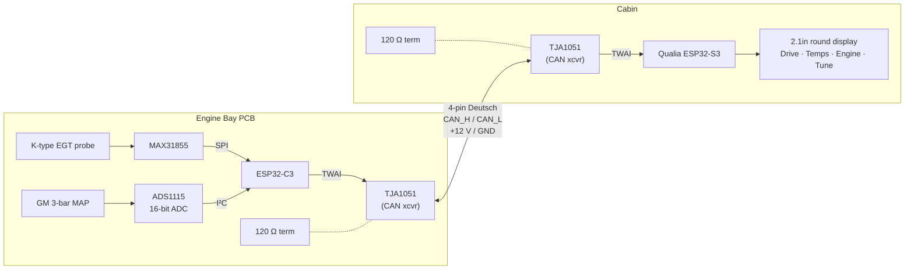
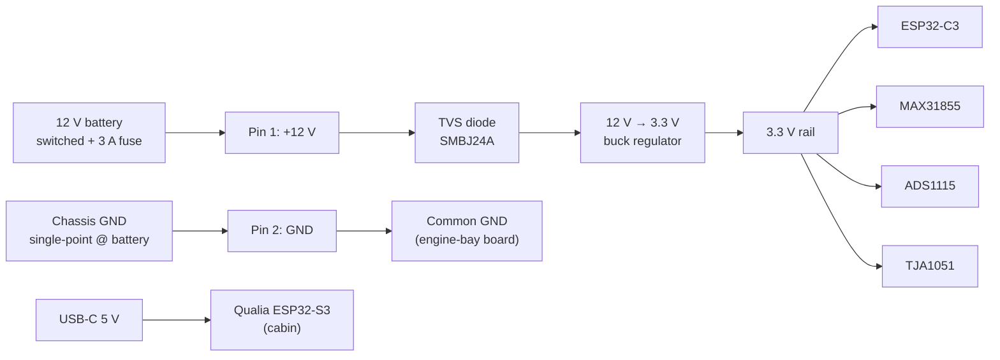

# junkr-obd: gauge, sensors and ECU tap for a 1KZ-TE Prado

A round dash gauge (Adafruit **Qualia ESP32-S3** + 2.1" 480×480 round
display in the dead clock hole), an engine-bay sensor node, and a zero-cut
ECU interposer with a logging tap box, all on one CAN bus. Piggyback only:
the stock ECU stays in charge.


## Where the numbers come from

| Quantity | Source | Notes |
| ------ | ----- | ----- |
| EGT, pre-turbo | engine-bay node | ungrounded K-type, MAX31855 |
| Boost (absolute) + baro | engine-bay node | GM 3-bar MAP teed into the stock PIM hose |
| Boost the ECU sees, RPM, timing, fuelling, pedal | ECU tap | from the interposer |
| Coolant, ATF, intake, fuel temps, volts, lamps | ECU tap | the ECU's own sensors |

Full plan: [`docs/SENSORS_GAUGE_LOGGING.md`](docs/SENSORS_GAUGE_LOGGING.md).

## System Block Diagram

Two MCUs, linked by CAN over a 4-pin Deutsch harness. Sensors terminate
locally on the engine-bay board (notably the K-type thermocouple — MAX31855
does cold-junction comp at its own die, so co-locating with the connector
is more accurate than running extension wire to the cabin). The cabin
Qualia is a CAN listener that updates the display.



## Harness Pinout (DT04-4P)

| Pin | Signal | Dir | Notes |
| --- | ------ | --- | ----- |
| 1 | +12 V (switched) | → | Fused upstream (3 A), feeds engine-bay buck |
| 2 | GND | — | Chassis ground, single-point at battery |
| 3 | CAN_H | ↔︎ | Twisted pair with CAN_L, 120 Ω term each end |
| 4 | CAN_L | ↔︎ | Twisted pair with CAN_H |

## Cabin ESP32-S3 (Qualia) Pin Map

| Function | Pin |
| -------- | --- |
| Display | Qualia RGB666 port + 40-pin ribbon (fixed by the board) |
| CAN TX (TWAI) | GPIO5 (header SCK) |
| CAN RX (TWAI) | GPIO6 (header MISO) |
| Page button (to GND) | A0 / GPIO17; the on-board DOWN button does the same |

## Engine-Bay ESP32-C3 Pin Map

(Pins chosen to avoid the SuperMini's onboard LED on GPIO8 and the boot
button on GPIO9, and the USB-Serial pins GPIO20/21.)

| Function | Pin |
| -------- | --- |
| MAX31855 SCK | GPIO4 |
| MAX31855 MISO | GPIO5 |
| MAX31855 CS | GPIO10 |
| ADS1115 A1 / A2 / A3 | MAP / spare sender / +5 V monitor (all via 2:1 dividers) |
| ADS1115 SDA | GPIO6 |
| ADS1115 SCL | GPIO7 |
| CAN TX (TWAI) | GPIO0 |
| CAN RX (TWAI) | GPIO1 |

## Calibration Constants

MAP (GM 3-bar, ratiometric): `kPa = 1.1 + 314.4 × V_sig / V_5V`, in
`src/engine_bay/map_math.h`. Baro is latched with the engine stopped.

## Power Supply

The cabin Qualia runs off USB-C (or its own switched-12 V→5 V adapter). The
engine-bay board is fed switched **12 V** through pin 1 of the Deutsch
harness, fused at ~3 A upstream, and steps it down locally with a 12 V→3.3 V
buck. Single-point ground at the battery; TVS diode on the engine-bay 12 V
input for load-dump protection.



## Bench Testing

Step-by-step bring-up guide — compile, then UI alone, then sensors alone,
then CAN loopback, then real sensors, **then** fab PCBs. See
[`docs/BENCH_TESTING.md`](docs/BENCH_TESTING.md). Bench-rig shopping
list with US suppliers: [`docs/BENCH_BOM.md`](docs/BENCH_BOM.md).

## Hardware

KiCad-ready specs for both PCBs live in [`kicad/`](kicad/) —
schematic netlists, BOMs with footprint references, design rules, and
placement/routing notes. See [`kicad/README.md`](kicad/README.md) for
the workflow.

3D models for enclosure design: [`docs/3D_MODELS.md`](docs/3D_MODELS.md)
(sourcing table + KiCad STEP-export workflow). The Qualia and ADS1115
STEP files are vendored under [`hardware/3d_models/`](hardware/3d_models/).

## Firmware Layout

One PlatformIO project; each environment picks its sources with
`build_src_filter`:

```
shared/can_protocol.h      # every CAN frame: IDs, payloads, pack/unpack
src/cabin/                 # env cabin / cabin-demo (Qualia ESP32-S3 gauge)
  gauge_state.h            #   frames -> values + alerts (pure, host-tested)
  ui.cpp                   #   LVGL pages (also runs on the PC, see below)
  display.cpp              #   Qualia RGB panel + LVGL glue
  button.h · demo.h · can_rx.cpp · main.cpp · fonts/ (Inter)
src/engine_bay/            # env engine-bay (ESP32-C3 SuperMini)
  map_math.h               #   3-bar curve + baro latch (pure, host-tested)
  sensors.cpp · can_bus.cpp · main.cpp
src/tap/                   # ECU tap box (ESP32-S3), piggyback lookup so far
src/preview/               # env gauge-preview: renders the pages to PNG
test/                      # pio test -e native
```

- **`engine-bay`** reads EGT and the 3-bar MAP, latches baro, and sends
  `0x100` EGT °F and `0x102` boost psi×10 at 20 Hz, plus `0x103` (absolute
  MAP, baro, 5 V rail, spare input) at 2 Hz. It listens for the tap's rpm
  to know when the engine is stopped. `0x101` (coolant) is retired.
- **`cabin`** listens to everything and shows five screens: Drive, Temps,
  Engine, Tune, and an Alert screen that takes over. One button pages,
  long press goes back to Drive. Without a tap box on the bus it still
  shows EGT and boost from the engine-bay node.
- **`cabin-demo`** is the same gauge fed by a built-in 90 s drive, for
  bench work with no bus.

Alert levels (pre-turbo EGT): EGT amber 1150 °F, red 1250 °F for 2 s;
coolant 221 / 230 °F; boost 15 / 17 psi; ATF 230 / 260 °F; check-engine
lamp with the engine running; battery under 12.4 V for 10 s running.

The CAN table (IDs 0x100–0x115, units, rates) is in
[`docs/SENSORS_GAUGE_LOGGING.md`](docs/SENSORS_GAUGE_LOGGING.md) §4 and,
authoritatively, in `shared/can_protocol.h`.

## Build / Flash / Test

```bash
pio run -e cabin -t upload           # gauge on CAN
pio run -e cabin-demo -t upload      # gauge with the demo drive, no bus needed
pio run -e engine-bay -t upload      # engine-bay node (engine-bay-debug prints values)
pio device monitor -e cabin

pio test -e native                   # host unit tests
pio run -e gauge-preview -t exec && python3 docs/gauge/firmware/convert.py
                                     # re-render docs/gauge/firmware/*.png
```

## ECU Interposer (in progress)

A zero-cut, printable pass-through between the KZJ95's 1KZ-TE ECU and its
harness, with an ESP32-S3 tap board that logs RPM, actual injection timing,
spill-valve fuelling, boost and temperatures. See
[`hardware/ecu_interposer/`](hardware/ecu_interposer/),
[`docs/ECU_INTERPOSER_RESEARCH.md`](docs/ECU_INTERPOSER_RESEARCH.md) and
[`docs/ECU_TAP_ARCHITECTURE.md`](docs/ECU_TAP_ARCHITECTURE.md).

### Learning tuner (simulation stage)

`tuner/` is a Python package that learns piggyback correction maps
(PIM and coolant-temp offsets over baro × intake temp × rpm × pedal) from
drive logs, with optional sensor modules (wideband, EGT, baro, GPS, IMU,
fuel flow) that unlock more authority. `src/tap/piggyback.h` is the
matching firmware lookup and safety caps. See
[`docs/LEARNING_TUNER.md`](docs/LEARNING_TUNER.md).

```
python -m tuner campaign --rounds 15 --drives 4
python -m unittest discover -s tuner/tests -t .
```
