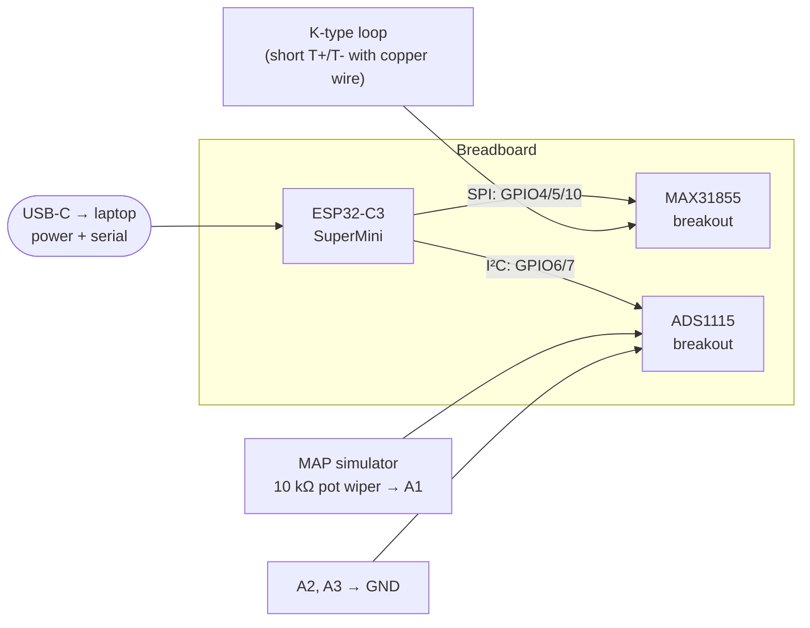
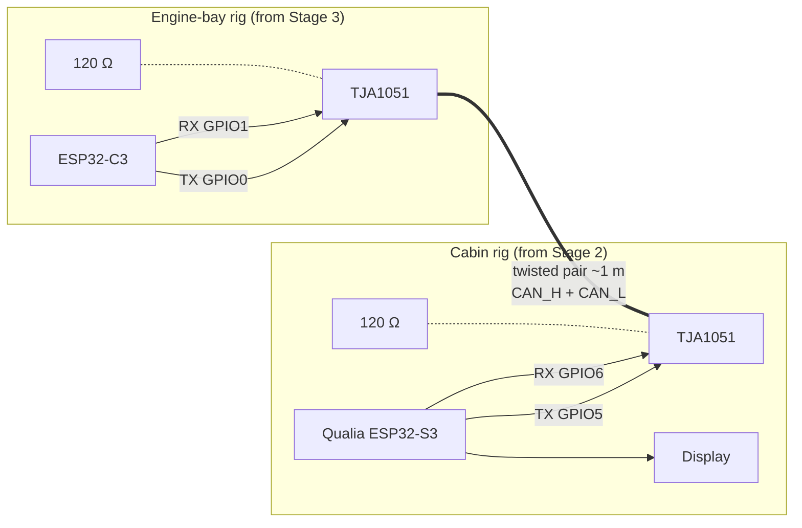
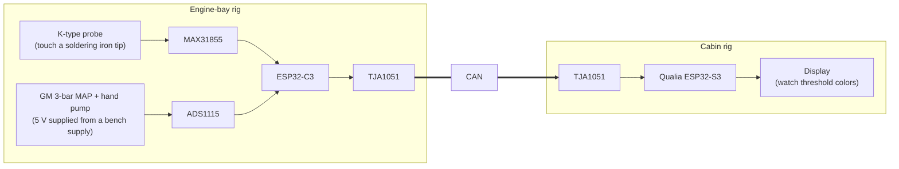

# Bench Testing Guide

Walks the system up from nothing to a fully-integrated CAN-linked gauge,
**before** ordering PCBs. Each stage gates the next — don't move on
until the previous one's pass criteria are met.

## What you'll need

For a US-supplier shopping list with links + costs, see
[`BENCH_BOM.md`](BENCH_BOM.md). The quick version:

**Hardware**

| Item | Used in stage |
| ---- | ------------- |
| Adafruit Qualia ESP32-S3 + 2.1" round 480×480 display (PID 5792 or 5806) + USB-C cable | 2, 4, 5 |
| ESP32-C3 SuperMini + USB-C cable | 3, 4, 5 |
| Adafruit MAX31855 breakout (PID 269) | 3, 4, 5 |
| Adafruit ADS1115 breakout (PID 1085) | 3, 4, 5 |
| Two TJA1051 / SN65HVD230 modules | 4, 5 |
| K-type thermocouple wire (a short loop also works) | 3, 5 |
| 10 kΩ resistors (×4, temporary 2:1 dividers for MAP and the 5 V monitor) | 5 |
| 10 kΩ trim pot or linear pot | 3 |
| 120 Ω resistors (×2 for CAN termination) | 4, 5 |
| Twisted pair wire, ~1 m | 4, 5 |
| Breadboard + jumpers | 3, 4 |
| GM 3-bar MAP sensor + hand pressure pump | 5, 6 |

**Software**

- PlatformIO Core (`pip install platformio`) or the VS Code extension.
- A serial monitor (PlatformIO has one: `pio device monitor`).

---

## Stage 1 — Compile and run the host tests

No hardware needed yet.

```bash
git clone <this repo>
cd junkr-obd
pio run -e cabin              # gauge, listening on CAN
pio run -e cabin-demo         # gauge, fed by synthetic frames
pio run -e engine-bay
pio test -e native            # protocol, MAP/baro math, alerts, button (host)
pio run -e gauge-preview -t exec && python3 docs/gauge/firmware/convert.py
```

**Pass criteria:** the three firmware builds succeed, all native tests
pass, and `docs/gauge/firmware/*.png` show the five pages. Those PNGs are
rendered by the real `ui.cpp` on the PC, so what you see there is what
the panel will draw.

### Common Stage-1 fixes

| Symptom | Fix |
| ------- | --- |
| `Adafruit_MAX31855.h: No such file` | First build downloads libs; run again, or `pio pkg install -e engine-bay`. |
| `Arduino_GFX_Library.h: No such file` | `pio pkg install -e cabin`. GFX Library for Arduino 1.6+ needs arduino-esp32 3.x; `platformio.ini` pins `espressif32 @ ^8.0.0` for that. |
| `lv_conf.h: No such file` | The cabin envs need `-I src/cabin` and `-DLV_CONF_INCLUDE_SIMPLE` in `build_flags`. |
| `can_protocol.h: No such file` | Make sure `[env] build_flags = -I shared` survived edits. |
| `pio test -e native` can't find `g++` | Install a host compiler (Xcode command line tools on a Mac). |

---

## Stage 2 — Gauge alone, demo mode

Just the Qualia, the 2.1" round display (TL021WVC02, PID 5792/5806) on
its 40-pin ribbon, and USB. No CAN transceiver.

```bash
pio run -e cabin-demo -t upload
pio device monitor -e cabin-demo
```

The demo plays a 90 s loop: idle, cruise with the piggyback armed, a hill
pull that runs EGT past 1250 °F, then cruise again.

**Pass criteria:**

- Serial prints `[cabin] demo mode: synthetic bus traffic, CAN not started`.
- The Drive page matches `docs/gauge/firmware/01_drive.png`: boost ring on
  the left, EGT ring on the right, the green `TUNE +6%` pill after ~18 s.
- The Qualia's **DOWN** button (or a button from header pin A0 to GND)
  steps Drive → Temps → Engine → Tune → Drive. A long press (0.8 s) jumps
  back to Drive.
- About 54 s into each loop the red **EGT HIGH** screen takes over. A short
  press hides it for 30 s (the Drive pill then reads `EGT HIGH` in red);
  it clears on its own once EGT drops under 1150 °F.
- Text sits inside the circle, nothing clipped at the edge.

### If the display is blank or garbled

| Symptom | Likely cause |
| ------- | ------------ |
| Backlight off, nothing at all | `[cabin] display init failed`: the I/O expander at 0x3F didn't answer. Reseat the ribbon; the Qualia must be the RGB666 version. |
| Backlight on, black | Wrong panel. The init sequence is `TL021WVC02_init_operations` (2.1" round); other Qualia panels need their own from Adafruit's examples, in `src/cabin/display.cpp`. |
| Colours swapped or shimmering | Panel timings. Copy the porch values for your panel from Adafruit's Qualia examples. |

---

## Stage 3 — Engine-bay reads alone

ESP32-C3 + the two sensor breakouts on a breadboard, with simulated
sensor inputs. CAN transceiver is not connected yet — we use the
`engine-bay-debug` environment so values stream out the serial.



### Wiring table

Power rails on the breadboard: one 3.3 V rail (from the C3's `3V3` pin)
and one GND rail.

**MAX31855 breakout**

| Breakout pin | Goes to |
| ------------ | ------- |
| VIN | 3.3 V rail |
| GND | GND rail |
| CLK | C3 GPIO4 |
| DO  | C3 GPIO5 |
| CS  | C3 GPIO10 |
| 3Vo | leave open |
| T+, T− | short together with a copper wire loop, **or** clip a K-type probe |

**ADS1115 breakout**

| Breakout pin | Goes to |
| ------------ | ------- |
| VDD | 3.3 V rail |
| GND | GND rail |
| SDA | C3 GPIO6 |
| SCL | C3 GPIO7 |
| ADDR | GND rail (selects address `0x48`) |
| ALRT | leave open |
| A0 | leave open (spare; coolant now comes from the ECU tap) |
| A1 | MAP simulator wiper |
| A2, A3 | GND rail. A3 at 0 V tells the firmware "no 5 V monitor", so it assumes 5.0 V. |

**MAP simulator**: a 10 kΩ pot between 3.3 V and GND, wiper to A1. The
firmware doubles every ADC reading to undo the PCB's 2:1 divider, so
0.80 V at A1 stands for 1.60 V at the sensor, about 101 kPa (sea level).

### Upload + monitor

Set the pot to about 0.8 V **before** reset: the node averages the MAP
reading for the first 0.5 s after power-up and keeps it as baro.

```bash
pio run -e engine-bay-debug -t upload
pio device monitor -e engine-bay-debug
```

**Pass criteria** (the debug print lands every 1 s):

```
[engine-bay] baro 101.7 kPa (latched)
EGT=72 F  MAP=101.7 kPa  baro=101.7  boost=0.0 psi  5V=0.00  aux=0.00 V   <- pot at 0.80 V
EGT=72 F  MAP=152.0 kPa  baro=101.7  boost=7.3 psi  5V=0.00  aux=0.00 V   <- pot at 1.20 V
EGT=72 F  MAP=227.5 kPa  baro=101.7  boost=18.3 psi ...                    <- pot at 1.80 V
```

- EGT should be roughly room temperature when T+/T− are shorted (MAX31855
  reports the cold-junction temp).
- MAP follows `1.1 + 314.4 × (V_sensor / 5 V)` kPa, the GM 3-bar curve in
  `src/engine_bay/map_math.h`.
- Pot at either end (below ~0.05 V or above ~2.45 V at A1) reads `nan`:
  that's the open/shorted-sensor detection, and the CAN frames carry the
  invalid marker.
- Power-cycle with the pot at 1.8 V: the log must say `baro 101.3 kPa
  (default)`, because 227 kPa is not a believable baro.

### Stage-3 gotchas

| Symptom | Likely cause |
| ------- | ------------ |
| EGT reads `NaN` or `-32768` | Thermocouple disconnected; MAX31855 fault. Check T+/T− short. |
| MAP always `nan` | A1 above 2.45 V or below 0.05 V; or A3 floating and reading a stray 4.6 V, so check A3 is grounded. |
| I²C errors / ADS reads zero | Forgot to tie ADDR to GND, or pull-ups missing (Adafruit breakout has onboard pull-ups — confirm jumper). |
| C3 keeps rebooting | GPIO0/1 momentarily floating at boot. Should be fine once TWAI starts. |

---

## Stage 4 — CAN loopback

Now wire both MCUs together over a short twisted pair through their
respective TJA1051 transceivers. Real sensors still aren't connected —
the engine-bay rig keeps the Stage-3 simulators.



### Wiring (both transceiver modules)

Same on both ends — engine-bay side connects to C3, cabin side to Qualia:

| TJA1051 pin | Engine-bay (C3) | Cabin (Qualia) |
| ----------- | --------------- | -------------- |
| VCC | 3.3 V | 3.3 V |
| GND | GND | GND |
| TXD | GPIO0 | GPIO5 |
| RXD | GPIO1 | GPIO6 |
| S (silent) | GND | GND |
| CANH | twisted pair → other end CANH | ← |
| CANL | twisted pair → other end CANL | ← |

Drop a **120 Ω resistor across CANH–CANL at each end** of the twisted pair.

Re-flash:

```bash
pio run -e engine-bay-debug -t upload      # uploads to C3 (one USB cable)
pio run -e cabin -t upload                 # uploads to Qualia (the other USB cable; not cabin-demo)
```

**Pass criteria:**

- Cabin's serial no longer says `[cabin] TWAI init failed`.
- Cabin display **updates with the Stage-3 simulator values** at ~20 Hz.
  Turn the pot — boost arc on the cabin moves immediately.
- With no tap box on the bus the pill reads `NO TAP`, coolant/ATF/volts
  show `--`, and boost comes from the engine-bay MAP. That's correct.
- Engine-bay debug serial keeps printing the same values, confirming TX
  is happening (the C3 sees no errors → frames are being ACK'd by the
  cabin end).

### Stage-4 gotchas

| Symptom | Likely cause |
| ------- | ------------ |
| Cabin display stays at `--` | One of the TJA1051 S-pins floating — must be tied to GND for normal mode. |
| Cabin shows nonsense values | Packing mismatch. Both ends use `shared/can_protocol.h`; `pio test -e native` checks it. |
| Bus errors / no frames | Forgot termination, or only terminated one end. Two 120 Ω terminations are correct for a 2-node bus. |
| Updates intermittent | Twisted pair not actually twisted, or running parallel to a noise source (USB cable bundle). |

---

## Stage 5 — Real sensors

Swap the Stage-3 simulators for the real parts. This is where you find
out if your chosen sensors agree with the firmware's constants.



### Real-sensor wiring

**MAP**: drop the pot. The MAP sensor needs 5 V — for the bench, give
it a bench supply or a USB-pin 5 V tap (the engine-bay PCB will have a
dedicated 12 V → 5 V buck on it, but on the breadboard, borrow 5 V
from the C3's USB pin if it exposes one, or from the Qualia's 5 V pad).

Wire MAP signal through a temporary 2:1 divider (10 kΩ + 10 kΩ) since
the on-PCB divider doesn't exist yet:

```
MAP sensor SIG ── 10 kΩ ── A1 ── 10 kΩ ── GND
```

Do the same for the 5 V monitor so the reading is ratiometric:

```
sensor 5 V ── 10 kΩ ── A3 ── 10 kΩ ── GND
```

### Pass criteria

- **EGT:** Touch the K-type probe to a soldering iron tip set to
  ~600 °F. Display should read within ±20 °F. The number and ring turn
  **amber at 1150 °F** and **red at 1250 °F**; after 2 s at or above
  1250 °F the **EGT HIGH** screen takes over. (A hot-air gun gets there.)
- **Boost:** Connect a hand pressure pump to the MAP port. Sweep
  0 → 20 psi against the pump's gauge. The arc should track within
  ±0.5 psi; **amber at 15 psi**, **red at 17 psi**, and **OVERBOOST**
  after half a second at 17.
- **Baro:** with the port open, the 0x103 frame's baro (and the
  engine-bay debug print) should match a local weather report's station
  pressure (not the sea-level-corrected one) within ~1 kPa.

### What to log

Note the actual voltage at each ADC input at known reference points.
This is the data you need for Stage 6.

---

## Stage 6 — Check the MAP calibration

The firmware is set up for the **GM 3-bar MAP** (12569240 / 16254609),
read ratiometrically: `kPa = 1.1 + 314.4 × V_signal / V_supply`. Those two
end points (`GM3BAR_KPA_AT_0V`, `GM3BAR_KPA_AT_VS` in
`src/engine_bay/map_math.h`) are the only constants to touch.

With a hand pump and its gauge:

1. Port open: ~1.6 V at the sensor, reads local baro (~101 kPa at sea
   level, ~82 kPa at 1,800 m).
2. 5, 10, 15, 20 psi gauge: compare the engine-bay debug `boost=` against
   the pump gauge. Within ±0.5 psi is good.
3. If it's off by a constant, adjust `GM3BAR_KPA_AT_0V`; if the error grows
   with pressure, adjust `GM3BAR_KPA_AT_VS`. Rerun `pio test -e native`
   (the tests check the curve's shape, not your numbers, so they will
   fail only if a constant is way off) and reflash.

A different sensor needs its own transfer curve in `gm3bar_kpa()`.

---

## Stage 7 — Fab the PCBs

Only when 1–6 are all green. By now you know:

- The firmware compiles and behaves.
- The CAN protocol works end-to-end.
- The display variant is correct.
- Every sensor reads sensible values.
- The MAP sensor calibration matches.
- The gauge pages and alerts look and behave right on the real panel.

Open `kicad/engine_bay/schematic.md` and `kicad/cabin/schematic.md`,
capture in KiCad, route per `kicad/DESIGN_RULES.md`, and send the
gerbers out. See [`kicad/README.md`](../kicad/README.md) for the full
workflow.
