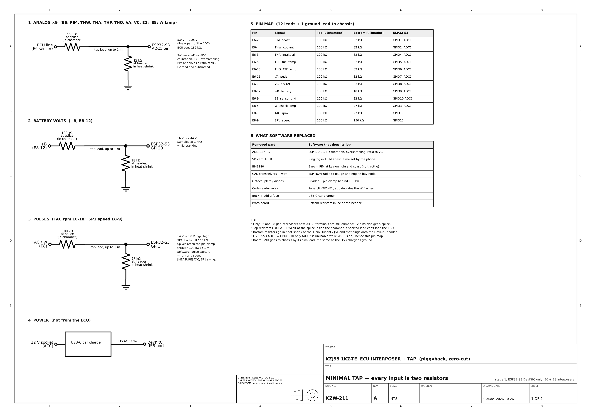
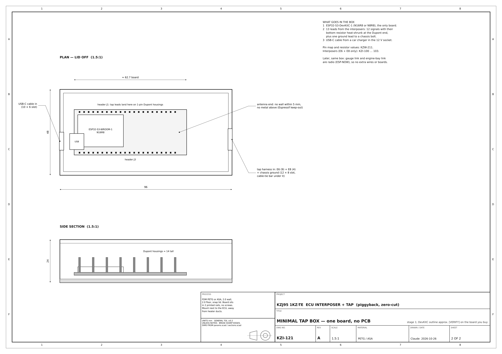
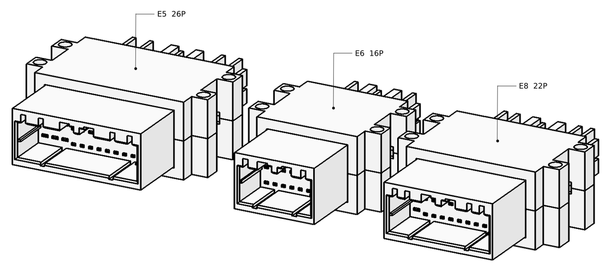
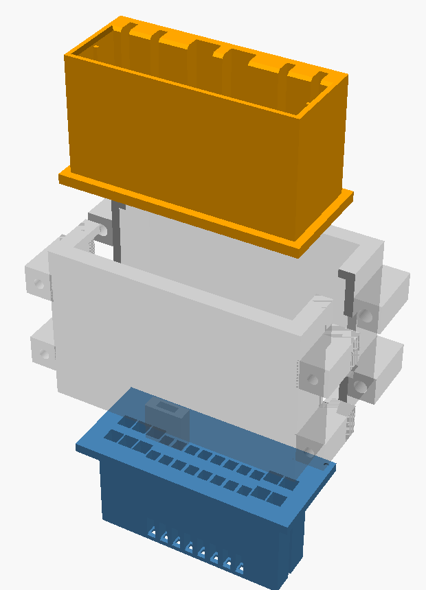
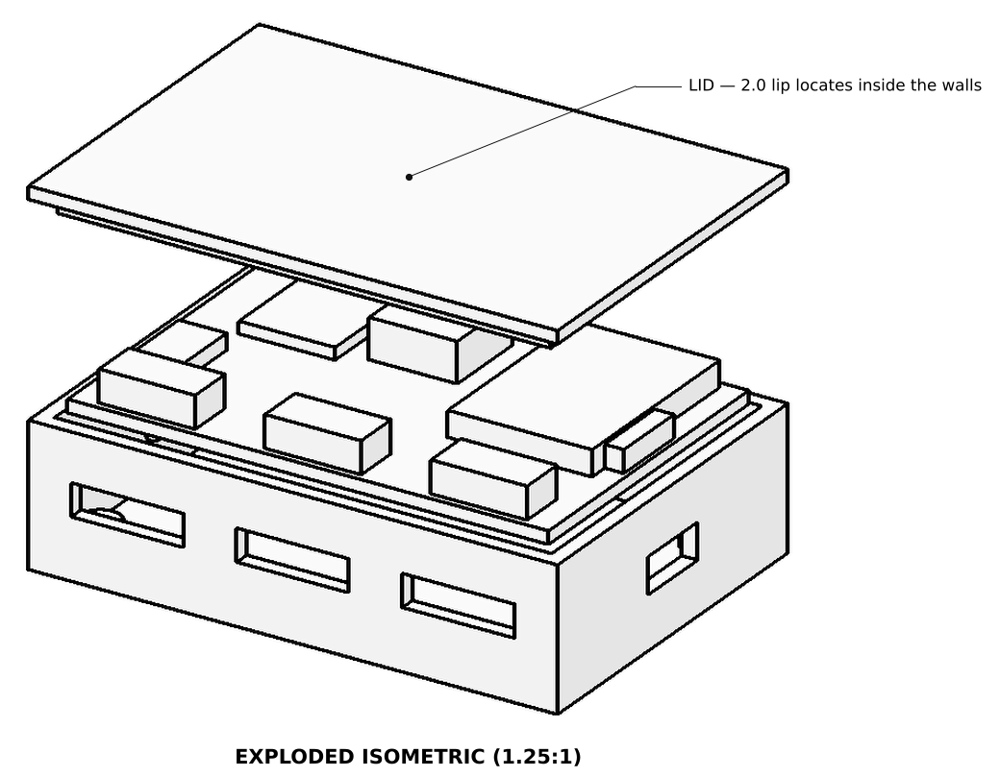
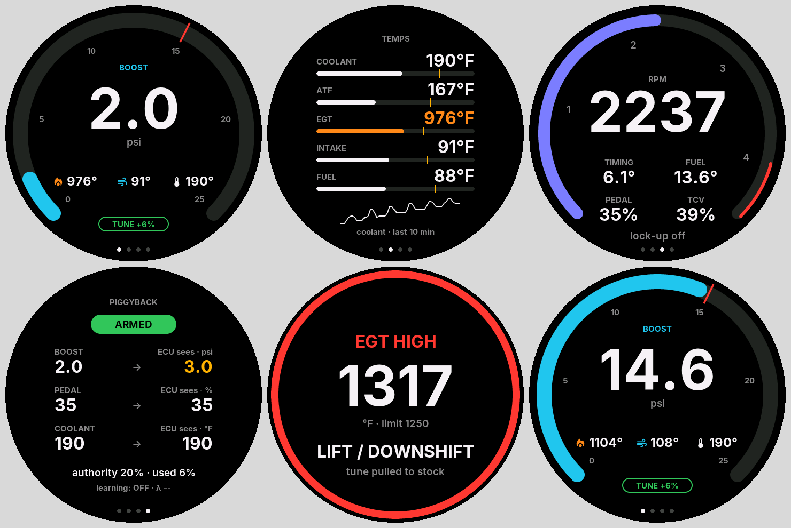

# Build Stages and Parts

Three stages, each with a parts list you can click through. Adafruit and
Pololu prices and stock were checked 2026-10-26; the rest are rough.

| Stage | You get | Parts |
| --- | --- | --- |
| 1. Tap + web app | Boost, temps, rpm, speed, volts, check-engine light, baro and logs on your phone | ~$90–130 |
| 2. Round gauge | Boost, temps, rpm and alerts on the dash | ~$55 |
| 3. Engine-bay box | EGT, real boost, outside air, extra temps | ~$230–380 |

```
            engine bay  ┆  cabin
 ┌────────────────────┐ ┆    ┌──────────────┐          ┌────────────────────┐
 │ Engine-bay node (3)│ ┆    │  Stock ECU   │          │ Phone web app  (1) │
 └─────────┬──────────┘ ┆    └──────┬───────┘          └─────────▲──────────┘
           ┆            ┆  E6 + E8 interposers                   ┆ Wi-Fi
           ┆            ┆    ┌──────┴───────┐                    ┆
           └┄ESP-NOW┄┄┄┄┼┄┄┄┄┤ Tap box  (1) ├┄┄┄┄┄┄┄┄┄┄┄┄┄┄┄┄┄┄┄┄┘
                        ┆    └──────┬───────┘
                        ┆           └┄ESP-NOW┄┄ Round gauge (2), clock hole
```

## Stage 1: Tap the ECU (minimal version)

One ESP32-S3 dev board, 24 resistors and two printed interposers. No PCB,
no add-on boards. Every input is two resistors, and the rest is software.





**Why there's any hardware at all:** the 1996 ECU has no data port, so you
read its sensor wires directly. Those carry 5 V and 14 V and the ESP32's
pins top out at 3.3 V, so each wire gets a 100 kΩ resistor at the splice
and a second resistor at the board. That's the whole circuit.

### What software replaced

| Was hardware | Now |
| --- | --- |
| 2× ADS1115 ADC | ESP32 ADC with eFuse calibration, 64× oversampling, readings taken as a ratio of the ECU's own 5 V (VC) |
| Optocouplers | Same two-resistor divider; the pin clamp takes the spikes through 100 kΩ (< 1 mA) |
| SD card + clock board | Ring log in the board's 16 MB flash; time comes from the phone |
| BME280 baro sensor | Boost sensor (PIM) read at key-on and at idle (a diesel has no throttle, so idle sees baro) |
| CAN transceivers + wiring | ESP-NOW radio, built into every ESP32 |
| Code-reader relay | Paperclip across TE1–E1; the app decodes the check-engine flashes on the W wire |
| Buck converter + add-a-fuse | USB-C car charger in the 12 V socket |

**What it costs in quality, honestly:**

- The ESP32 ADC is about ±1 % after calibration (the ADS1115 was ±0.1 %).
  Fine for boost and temps. An ADS1115 can be added on the I²C pins later
  with no rewiring.
- The flash log holds roughly 15–30 hours of driving before it wraps. Pull
  logs to the phone.
- Wireless can drop out. The gauge greys out stale numbers, and anything
  safety-related stays on the tap box.

### Pin map

| Pin | Wire | Top | Bottom | Board pin |
| --- | --- | --- | --- | --- |
| E6-2 | PIM (boost) | 100k | 82k | GPIO1 |
| E6-4 | THW (coolant) | 100k | 82k | GPIO2 |
| E6-3 | THA (intake air) | 100k | 82k | GPIO4 |
| E6-5 | THF (fuel temp) | 100k | 82k | GPIO5 |
| E6-13 | THO (ATF temp) | 100k | 82k | GPIO6 |
| E6-11 | VA (pedal) | 100k | 82k | GPIO7 |
| E6-1 | VC (5 V reference) | 100k | 82k | GPIO8 |
| E6-9 | E2 (sensor ground) | 100k | 82k | GPIO10 |
| E8-12 | +B (battery volts) | 100k | 18k | GPIO9 |
| E8-5 | W (check-engine light) | 100k | 27k | GPIO3 |
| E8-18 | TAC (rpm) | 100k | 27k | GPIO11 |
| E8-9 | SP1 (speed) | 100k | 150k | GPIO12 |

The top resistor sits at the splice inside the interposer, so a shorted
lead can't upset the ECU. The bottom resistor goes in heat-shrink at the
Dupont end that plugs onto the board.

### Why not the custom tap board

It only adds E5: injection timing and fuel quantity, read off the pump
sensors and spill valve. Its parts were backordered and its 4-layer layout
isn't done. Nothing in stages 1–3 needs E5, so it waits. The E5
interposer is already drawn if you want it later
([`kicad/tap/bom.csv`](../kicad/tap/bom.csv)).



| One interposer, exploded | Old tap box, for reference |
| --- | --- |
|  |  |

### Buy

| Part | Qty | ~$ | Link |
| --- | --- | --- | --- |
| ESP32-S3-DevKitC-1 **N16R8** (16 MB flash) | 1 | 15 | [Amazon](https://www.amazon.com/s?k=esp32-s3-devkitc-1+n16r8) · [Digi-Key](https://www.digikey.com/en/products/result?keywords=ESP32-S3-DEVKITC-1-N16R8) |
| 1 % resistor kit, E24 values (needs 100k, 82k, 27k, 18k, 150k) | 1 | 12 | [Amazon](https://www.amazon.com/s?k=1%25+metal+film+resistor+kit+E24) |
| Dupont jumper leads, female, + heat-shrink | 1 | 12 | [Amazon](https://www.amazon.com/s?k=dupont+jumper+wire+female+heat+shrink+kit) |
| USB-C car charger + 1 m USB-C cable | 1 | 12 | [Amazon](https://www.amazon.com/s?k=usb+c+car+charger+with+cable) |
| 22 AWG stranded wire | 1 | 10 | [Amazon](https://www.amazon.com/s?k=22+awg+stranded+wire+kit) |
| Interposer prints, E6 + E8 (MJF nylon or resin) | 1 set | 20–40 | [JLC3DP](https://jlc3dp.com/) |
| Tap box (print it yourself, PETG) | 1 | 0 | — |
| **040 receptacle**, TE 175061-1 | 40 | 6 | [Digi-Key](https://www.digikey.com/en/products/result?keywords=175061-1) · [Mouser](https://www.mouser.com/c/?q=175061-1) |
| **040 tab**, TE 173682-1 | 40 | 6 | [Digi-Key](https://www.digikey.com/en/products/result?keywords=173682-1) · [Mouser](https://www.mouser.com/c/?q=173682-1) |
| **070 receptacle**, TE 173631-1 | 10 | 3 | [Digi-Key](https://www.digikey.com/en/products/result?keywords=173631-1) · [Mouser](https://www.mouser.com/c/?q=173631-1) |
| **070 tab**, TE 173645-1 | 10 | 3 | [Digi-Key](https://www.digikey.com/en/products/result?keywords=173645-1) · [Mouser](https://www.mouser.com/c/?q=173645-1) |
| Open-barrel crimper (skip if you have one) | 1 | 25 | [Amazon](https://www.amazon.com/s?k=open+barrel+terminal+crimper+sn-28b) |

Terminal counts: E6 is 16 × 040 and E8 is 16 × 040 plus 6 × 070, each
pin getting one receptacle and one tab, plus spares. If TE stock is short,
a junkyard Toyota ECU pigtail gives you the same terminals.

### Baro and codes

- **Baro:** no sensor. The boost sensor reads true baro at key-on and at
  idle, and the app keeps the last value. Outside temp comes in stage 3,
  behind the grille.
- **Codes:** key on, engine off, bridge **TE1–E1** in the check connector
  under the hood with a paperclip. The app watches the W wire and turns the
  flashes into code numbers.

## Stage 2: Round gauge

The firmware is already written. These are its real screens:



### Buy

| Part | Qty | ~$ | Link |
| --- | --- | --- | --- |
| Qualia ESP32-S3 | 1 | 19.95 | [Adafruit 5800](https://www.adafruit.com/product/5800) |
| 2.1" round display, no touch (touch version $39.95, [5792](https://www.adafruit.com/product/5792)) | 1 | 24.95 | [Adafruit 5806](https://www.adafruit.com/product/5806) |
| 12 V → USB-C 5 V converter, hardwired to the clock plug | 1 | 10 | [Amazon](https://www.amazon.com/s?k=12v+to+usb+c+step+down+converter+hardwire) |
| Momentary button (if the clock buttons are gone) | 1 | 3 | [Amazon](https://www.amazon.com/s?k=12mm+momentary+push+button) |

It talks to the tap box over ESP-NOW, so the only wire is power from the
old clock plug. The firmware was written for CAN; swapping it to ESP-NOW
keeps the same messages and is a small change. The bezel gets printed once
the clock hole is measured.

## Stage 3: Engine-bay sensor box

| Sensor | Where |
| --- | --- |
| EGT | Pre-turbo, in the exhaust manifold collector |
| 3-bar MAP | Firewall, teed into the stock PIM hose |
| Outside air temp | Behind the grille, out of radiator airflow |
| Radiator outlet temp | Lower radiator hose |
| Turbo outlet air temp | Pipe from the turbo to the intake |
| Oil temp | Sump drain plug |
| Wideband (later) | Downpipe |

Everything wires to one IP65 box on the firewall. An ESP32-C3 reads the
five 0–5 V and temperature inputs on its own ADC (resistors from the stage 1
kit), the MAX31855 reads the thermocouple (the one job software can't do),
and it sends to the tap box over ESP-NOW. Coolant and intake temps already
come from the ECU.

### Buy

| Part | Qty | ~$ | Link |
| --- | --- | --- | --- |
| ESP32-C3 SuperMini (one spare) | 2 | 8 | [Amazon](https://www.amazon.com/s?k=esp32-c3+supermini) |
| MAX31855 thermocouple amp | 1 | 14.95 | [Adafruit 269](https://www.adafruit.com/product/269) |
| 5 V 500 mA buck D24V5F5 | 1 | 9 | [Pololu 2843](https://www.pololu.com/product/2843) |
| IP65 box ~80×60×30 mm + cable glands | 1 | 15–25 | [Amazon](https://www.amazon.com/s?k=ip65+abs+junction+box+small+cable+gland) |
| **EGT probe**, K-type ungrounded, 1/8" NPT, open tip | 1 | 25–60 | [Amazon](https://www.amazon.com/s?k=egt+probe+k+type+ungrounded+1%2F8+npt) |
| K-type extension lead, braided, 1.5 m | 1 | 10–15 | [Amazon](https://www.amazon.com/s?k=k+type+thermocouple+extension+braided) |
| 1/8"-27 NPT tap + 11/32" drill | 1 | 15 | [Amazon](https://www.amazon.com/s?k=1%2F8-27+npt+tap+11%2F32+drill) |
| **GM 3-bar MAP** 12569240 + pigtail | 1 | 25–45 | [Amazon](https://www.amazon.com/s?k=gm+3+bar+map+sensor+12569240+pigtail) |
| 1/8" barbed tee + 3 ft vacuum hose | 1 | 5 | [Amazon](https://www.amazon.com/s?k=1%2F8+barbed+tee+vacuum+hose) |
| Air temp sensors (outside air + turbo outlet), GM open-element | 2 | 20–30 | [Amazon](https://www.amazon.com/s?k=gm+open+element+intake+air+temperature+sensor) |
| Radiator hose temp adapter + sender | 1 | 20–35 | [Amazon](https://www.amazon.com/s?k=radiator+hose+temperature+sensor+adapter) |
| Oil temp sender + drain-plug adapter (measure the thread first) | 1 | 20–40 | [Amazon](https://www.amazon.com/s?k=oil+temperature+sender+drain+plug+adapter) |
| Wideband O2, later: Bosch LSU 4.9 + controller with 0–5 V output | 1 | 200–300 | [Amazon](https://www.amazon.com/s?k=14point7+spartan+3+lsu+4.9) |

## Decide

- [ ] Go with the minimal stage 1 (dev board, resistors, interposers)? Recommended.
- [ ] Switch the gauge firmware from CAN to ESP-NOW? Recommended; CAN stays possible.
- [ ] Intercooler or not? Sets where the turbo-outlet sensor goes.
