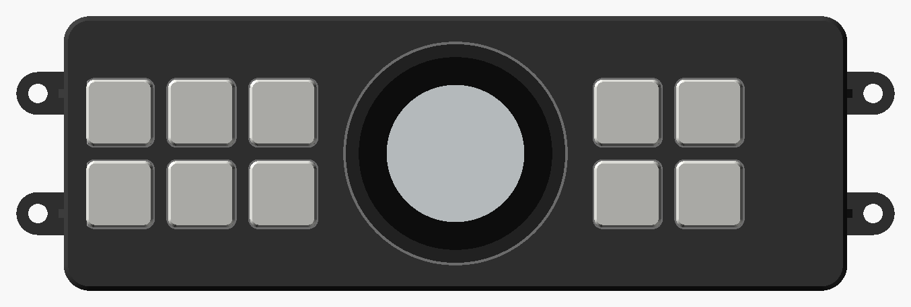

# Climate panel replacement: design and technical restrictions

A new face for the stock climate control panel: the same buttons, and one
big temperature knob with a round screen in the middle. The stock A/C
amplifier, servos, sensors and harness all stay exactly as they are; the new
panel only presses the stock panel's switches for you. Nothing on the truck
gets cut.



CAD: [`hardware/climate_panel/`](../hardware/climate_panel/) (OpenSCAD,
every dimension in `cad/params.scad`). Knob firmware: [`src/climate/`](../src/climate/)
(`pio run -e climate -t upload`; host tests in `test/test_climate`).
Build guide: `build-guides/Climate-Panel-Build-Guide.pdf` in the project files.

## 1. Which stock panel this assumes

The KZJ95 came with two climate panels:

| | Manual A/C | Automatic ("climate control type") |
| --- | --- | --- |
| Controls | three rotary dials (fan, temperature, mode), A/C and recirc buttons | push buttons, LCD with the setpoint, AUTO / OFF |
| Temperature | dial on a cable or a servo | TEMP up / down buttons, the A/C amplifier drives an air-mix servo |
| This design | needs a different knob (see §7) | **what this design is drawn for** |

"The same buttons, plus a big temperature knob" reads like the automatic
panel, so that is the default. **Confirm it with a photo of the panel.** If
the truck has the three-dial panel, §7 says what changes.

I couldn't confirm anything below from the web: the parts catalogues
(Amayama, ToyoDIY) block automated reading and there's no published KZJ95
A/C pinout. The EWD on Connor's Desktop (`EWD269F`) has the A/C pages and is
the real source. Everything that depends on it is marked **[EWD]**, and
everything that needs a tape measure is marked **[MEASURE]**.

## 2. How a 1990s Toyota auto A/C works (what the EWD should confirm)

The pattern Toyota used on its mid-90s automatic A/C, and what to look
for on the KZJ95 pages: **[EWD]**

- **A/C amplifier**: the computer. On some models it is inside the control
  panel; on others it is a separate box (often behind the glovebox) and the
  panel is just switches, an LCD and maybe a small serial link. *Which one
  the KZJ95 has decides how hard a full replacement is (§6), but the
  approach here works either way.*
- **Air-mix servo**: a DC motor with a position potentiometer. The amplifier
  runs it to whatever blend gives the setpoint, using the sensors below.
- **Mode servo** (face / bi-level / feet / feet-defrost / defrost) and
  **air-inlet servo** (fresh / recirc): DC motors with position contacts.
- **Blower**: a power transistor (linear speed) plus an extra-high relay,
  both driven by the amplifier.
- **Sensors**: room temperature (with an aspirator), ambient, solar,
  evaporator temperature, and often a coolant temperature switch for
  warm-up blower delay.
- **Compressor**: the amplifier asks for A/C; the magnetic clutch relay,
  the dual/triple pressure switch and (on many Toyotas) a compressor lock
  sensor sit in the path. The engine ECU is told too: on this truck
  `E8-10 A/C` (magnetic clutch signal) and `E8-19 ACT` (A/C cut from the
  amplifier) are in the ECU pinout, so the stage 1 tap can log the clutch.

## 3. The approach: re-face the stock panel

The new panel never drives a servo, a blower or a clutch. It only presses
the stock panel's own switches:

```
 new key switch ──────────── wire ─────────── stock switch pads  (AUTO, OFF, A/C, MODE, REC,
                                                                  DEF, R.DEF, FAN+, FAN-)
 M5Stack Dial ─ G1 ─ 330R ─ photoMOS ═══════ stock TEMP UP pads
             ─ G2 ─ 330R ─ photoMOS ═══════ stock TEMP DOWN pads
             ─ G13 ─ 330R ─ photoMOS ══════ stock AUTO pads (screen press)
```

- **Every button except temperature is a plain key switch wired in
  parallel with its stock switch.** No electronics in between, so DEF and
  the fan keep working even if the knob is dead or unplugged.
- **The knob** is an M5Stack Dial: a 51 mm knob with an encoder, a 1.28"
  round touch screen and an ESP32-S3. Each detent closes the TEMP UP or
  TEMP DOWN photoMOS for 90 ms, exactly like a finger on the stock button.
  The screen shows the setpoint. Pressing the screen is AUTO.
- **PhotoMOS relays** (CPC1017N or similar) isolate the Dial from the stock
  board completely. They don't care whether the stock switch goes to
  ground, to +5 V or sits in a scan matrix, as long as it's a logic-level
  switch.
- **The stock panel's board stays in circuit**, plugged into the stock
  harness, behind or near the new face. Work on a **used spare panel** so
  the original stays untouched and the swap back is one plug.

Why this way first: it needs no pinout to work, it can't upset the A/C
amplifier's control loops, it keeps every safety interlock Toyota put in,
and it is three relays plus wire. It's the same piggyback idea as the
ECU tap.

### What it costs

- **The stock LCD goes away** (unless you keep a window for it, below). In
  AUTO the amplifier picks the fan speed and mode itself and shows them on
  that LCD; the Dial can't know them. The Dial only shows the setpoint.
  Getting those back means reading the LCD driver or the amplifier (§6).
- **The knob doesn't know the amplifier's real setpoint.** It keeps its own
  copy in flash. They stay in step because nothing else can change the
  setpoint, and the amplifier keeps it on +B. After a battery disconnect,
  or if a press is ever missed, **hold the screen for 2 s**: the Dial
  presses DOWN 32 times (past LO), then counts back up to your setpoint
  (about 7 s). The first boot does this automatically.
- **Soldering on the stock board** (two wires per button, plus the
  indicator LEDs). That's why the spare panel.

## 4. Technical restrictions

### Electrical

| Restriction | Why | Design response |
| --- | --- | --- |
| PhotoMOS only across logic-level switch contacts (< 60 V, < 100 mA) | The panel switches are signal lines into the amplifier; anything carrying blower, servo or clutch current would cook a photoMOS | Only TEMP UP / DOWN and AUTO; measure the open-circuit voltage across each pad pair first (expect 5 V or less) |
| Don't feed the Dial straight from the 12 V line | Load dump and cranking transients; the Dial's 6-36 V input has no automotive protection | Same hardwired 12 V → USB-C converter as the stage 2 gauge, fed from IG |
| Press length and spacing are guesses | The amplifier debounces, and may auto-repeat if a button is held (often > 0.5 s) | `PULSE_MS = 90`, `GAP_MS = 110` in `climate_logic.h`; tune on the truck so one detent is always exactly one step |
| Setpoint range is a guess | JDM Toyota is usually LO, 18.0-32.0 °C in 0.5 °C, HI (30 steps) | `Scale` in `climate_logic.h`; count the steps on the truck |
| Matrix-scanned switches | If the stock panel scans its keys, a press must last a few scan cycles | 90 ms covers any normal scan rate; a matrix also means two pads per key may not be "switch to ground", which is fine for photoMOS and for plain key switches |
| Indicator LEDs (A/C, REC, AUTO, DEF, R.DEF) | They live on the stock board and are driven by the amplifier | Move each LED to the new key switch on two wires (MX switches have a slot for a 3 mm LED); no electronics |
| Panel lighting | Toyota dims the panel lights with the headlamp rheostat, often on the low side (ILL-) **[EWD]** | Backlight the caps from the stock ILL+ / ILL- with a series resistor; later, read TAIL on the Dial's spare G15 to dim the screen |
| Defrost must always work | Visibility | DEF and R.DEF are hard-wired switches; the Dial is not in their path |
| SRS | The passenger airbag and its yellow harness are nearby | Don't route new wires along or tape them to the SRS harness |

### Mechanical

| Restriction | Why | Design response |
| --- | --- | --- |
| Opening height vs the 51 mm Dial | The Dial is 51.0 mm across; with a 2 mm skirt wall it needs about 56 mm of opening height | Default opening is a 176 × 58 mm **guess**. Under 56 mm, use a smaller knob (§7) or a raised knob pod |
| Free depth behind the opening | Dial body 22 mm behind the face, key switches 26 mm, skirt 30 mm, then the stock board | `skirt_d` = 30 mm; measure the free depth to the first obstruction |
| Where the stock board goes | It must stay plugged in | Behind the new skirt if depth allows, otherwise in the cavity beside it on a short extension. **[MEASURE]** |
| Stock screw positions | The new face reuses them | `ears` and `ear_z` in `params.scad`, **[MEASURE]** |
| Which part of the Dial turns | The cup must grip only the fixed base | `dial_grip_from` = 12 mm; check on the real Dial before printing the switch plate |
| Dash heat | A dash in the sun passes 80 °C; PLA softens at about 55 °C | Print in **ASA** (best) or PETG; caps in resin or MJF PA12. Never PLA in the truck |
| Dial operating temperature | Consumer electronics, rated about 0-40 °C | Fine in the cabin when driving; it sits in a dash hole, not on top of it. Watch for screen ghosting after a hot day |
| Cap stem fit | FDM cross stems vary a lot | Print `cap_test.stl` first and tune; resin caps fit best |

### Software

- The Dial firmware is small: `climate_logic.h` (pure logic, 7 host tests)
  and `main.cpp` (Dial I/O, screen, flash).
- The Dial has Wi-Fi and ESP-NOW, so it can join the rest of the project
  later: send the setpoint and A/C state to the gauge and the log, or let
  the tuner web app see it. Not done yet.

## 5. What to measure and check (the build guide walks through it)

1. A straight-on photo of the panel (which of the two in §1).
2. Opening width, height, corner radius; free depth behind; dash wall
   thickness at the screws.
3. Positions of the stock mounting screws.
4. With the spare panel open: is the A/C amplifier on this board, or is it
   switches + LCD only? Photo of both sides of the board.
5. The voltage across each switch's pads, open (expect ≤ 5 V), and which
   pads are TEMP UP / TEMP DOWN / AUTO.
6. On the truck: does one press move exactly one 0.5 °C step? What happens
   if you hold the button? How many presses from LO to HI? Does it beep?
7. On the real Dial: which part turns, and how tall is the fixed base?

## 6. Later: a full replacement (not designed yet)

Driving the HVAC directly, without the stock board, is possible but is a
different project. It needs, from the EWD:

- the amplifier connector pinout;
- H-bridges for three servos with position feedback (air mix, mode, inlet);
- blower power transistor drive and the extra-high relay;
- the compressor request **with every interlock Toyota had**: evaporator
  freeze protection, the pressure switch, the lock sensor, and the `ACT`
  signal to the engine ECU (idle-up and A/C cut at full throttle);
- the room, ambient, solar and evaporator sensors, and a control loop
  that's at least as good as Toyota's.

Get the re-faced panel working and a few weeks of logs first. A middle
step is reading the stock LCD's driver lines so the Dial can show fan and
mode again.

## 7. If the truck has the three-dial manual panel

- The temperature dial turns a cable or a servo pot. The big knob becomes
  **a printed knob on the stock temperature spindle**, no electronics: set
  `buttons` to the A/C and REC switches and replace the Dial cup with a
  spindle adapter (the stock knob's shaft profile is [MEASURE]).
- If it's a servo pot, the Dial can drive it instead, but that needs the
  EWD and becomes §6.

## Files

| File | What |
| --- | --- |
| `hardware/climate_panel/cad/params.scad` | every dimension and the button list |
| `hardware/climate_panel/cad/panel.scad` | the parts: `faceplate`, `switch_plate`, `cap`, `rear_cover`, `sleeve`, `fit_frame`, `cap_test` |
| `hardware/climate_panel/cad/export_all.sh` | writes `stl/` and `renders/` |
| `src/climate/climate_logic.h` | setpoint scale, press timing, homing |
| `src/climate/main.cpp` | M5Stack Dial firmware |
| `test/test_climate/test_main.cpp` | host tests: `pio test -e native` |
