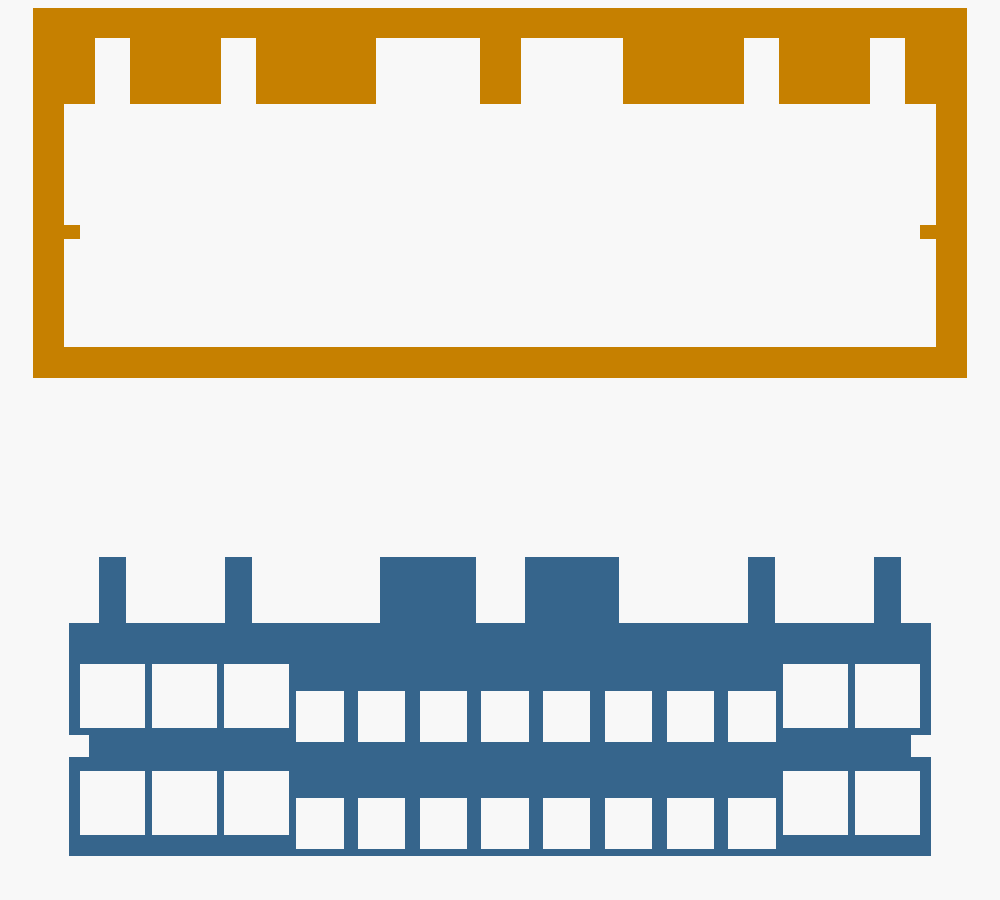

# 1KZ-TE ECU Interposer: Research Notes

Phase 1 research for a zero-cut, plug-in "splice harness" that sits between
the engine ECU and its harness on a **1996–2002 KZJ95 Land Cruiser Prado
(1KZ-TE, 3.0 L turbo-diesel)**.

> Status: desk research only. Nothing below has been measured on the
> truck yet. Items marked **[VERIFY]** need the workshop manual or a
> caliper/multimeter on the real ECU before parts are printed or wired.

---

## 1. Which 1KZ-TE is this?

The KZJ95's 1KZ-TE is the **electronically controlled** version (Toyota
"EFI-diesel" / Denso **ECD-V3**), not the mechanical-pump 1KZ-T:

- The 1KZ-T uses a fully mechanical injection pump. The 1KZ-TE replaced
  that with an electronically controlled distributor pump
  ([Wikipedia: Toyota KZ engine](https://en.wikipedia.org/wiki/Toyota_KZ_engine)).
- Owners' diagnostics on KZJ95s reference the Denso ECD-V3 pump, its
  **spill control valve (SPV)**, **timing control valve (TCV)**, two
  **NE sensors** and the pump **correction resistors**
  ([IH8MUD: 1KZ-TE no start](https://forum.ih8mud.com/threads/1kzte-no-start.1328476);
  [TaT: 2001 KZJ95R no spill-valve feed](https://www.tat.net.au/tatsafact/5162)).
- Toyota's **1KZ-TE Engine Supplement RM790E** covers KZN165 Hilux,
  KZN185 4Runner and **KZJ90/KZJ95 Land Cruiser Prado**. Its ECU terminal
  table is on pages **DI-18 to DI-23**
  ([RM790E excerpt](https://pdfcoffee.com/1kz-te-engine-sup-rm790e-pdf-free.html)).

What that means: the ECU decides **both fuel quantity and injection
timing**. Fuel quantity comes from when the SPV closes and opens during each
pump stroke. Timing comes from the TCV's duty cycle, which moves the pump's
timer piston. So fuel and timing both show up as electrical signals on the
ECU connector, which is good news for this project.

**[VERIFY]** Read the sticker on Connor's ECU: Toyota `89661-xxxxx` and
Denso `175800-xxxx`. That tells us A/T vs M/T and the market (JDM KZJ95W,
EU "Colorado", or AU KZJ95R).

## 2. ECU location and connectors

- **Location:** behind the glovebox, on the passenger side. RM790E's
  knock-sensor check tells you to remove the glove compartment to reach the
  ECU connector **[VERIFY on RHD vs LHD]**.
- **Connectors:** three harness plugs, **A = 22 pin, B = 16 pin,
  C = 26 pin, 64 pins in total.** This comes from the 1KZ-TE
  engine-control-computer terminal tables for the KZN130
  ([hiluxsurf.co.uk](https://hiluxsurf.co.uk/filedata/fetch?id=1295023)).
  The KZN130 is the same engine and ECU generation. The A/T table fills all
  64 positions, and the M/T table leaves some empty.
- **Connector family:** a 64-way **TE/AMP Multilock hybrid** header,
  **TE 176122-6** ("hybrid cap assy 64P"). It is also used on 1994 Camry
  and MR2 Turbo ECUs ([rusEFI forum](https://rusefi.com/forum/viewtopic.php?p=33084);
  [rusEFI OEM connectors wiki](https://github.com/rusefi/rusefi/wiki/OEM-connectors)).

### 2.1 Header dimensions (measured)

rusEFI publishes a KiCad footprint and a 3D model of 176122-6
([rusefi/kicad-libraries](https://github.com/rusefi/kicad-libraries)). We
measured the mesh (±0.05 mm) and cross-checked it against TE's published
5.2 mm row spacing on the mating plug 175110-6. Every number in
`hardware/ecu_interposer/cad/sections.scad` comes from this.

| Feature | Value |
| --- | --- |
| Overall length (with mounting ears) | 117.8 mm |
| Body | 108.96 × 18.5 mm |
| Section order (left to right, from the mating face) | C26, B16, A22 |
| Cavity lengths | C26 **42.44**, B16 **25.20**, A22 **35.42** mm |
| Wall between sections | 5.95 mm (centre gap); outer walls 1.48 mm |
| Cavity height | 11.82 mm (floor to rib undersides); slots between ribs reach **15.02 mm** |
| Cavity depth (mouth to floor) | 14.5 mm |
| Row spacing | **5.2 mm** (two rows per section) |
| 040 rows | 1.85 / 7.05 mm above the floor; **3.0 mm** column pitch; tab 0.98 × 0.62 mm, tip 7.09 mm proud of the floor |
| 070 rows | 1.0 mm higher (2.85 / 8.05 mm); **3.5 mm** column pitch; tab 1.78 × 0.62 mm, tip 7.99 mm proud |
| 070 → 040 column step | 3.1 mm |
| Polarising rails | on both end walls of each cavity, mid-height (C/A: 5.26–5.94 mm, 0.8 proud; B: 6.12–7.08 mm, 0.5 proud) |
| Keying | a different rib/slot pattern on the top wall of each section (listed in `sections.scad`) |

Column layout: **C26** = 070 ×3 | 040 ×8 | 070 ×2. **B16** = 040 ×8.
**A22** = 070 ×1 | 040 ×8 | 070 ×2.

**Not in the model, still [MEASURE]:** the harness plug's latch and the
header's lock ramp (the CAD has an optional `lock_window` for it), and
the exact receptacle body sizes inside the plug (`T040` / `T070` in
`params.scad`).

### 2.2 Part numbers

| Part | TE number | Notes |
| --- | --- | --- |
| ECU header (on the board) | **176122-6** | what we copy for `male_shroud` |
| Harness plug, 22 pin (A) | **175110-6** | 31.4 × 36.1 × 21.0 mm |
| Harness plug, 16 pin (B) | **175109-6** | |
| Harness plug, 26 pin (C) | **175111-x** (inferred from the series); 175567-1 is a possible alternative | [VERIFY] from the plug's moulding |
| 040 receptacle (goes in our `female_plug`) | **175061-1**, 175062-1, 173681-6 | 24–20 AWG |
| 070 receptacle | **173631-1** (or -8) | 20–16 AWG, insulation Ø 2.0–2.6 mm |
| 040 tab (goes in our `male_shroud`) | **173682-1** (175206-1 is the older, not-for-new-designs part) | |
| 070 tab | **173645-1** | |
| Application spec | 114-8005 | crimp heights and pull-out forces |
| Hand crimp tool | 58521-1 / 58521-2 | a generic open-barrel crimper works with care |

Sources: [TE 173631-1 datasheet](https://www.te.com.cn/chn-zh/product-173631-1.datasheet.pdf),
[TE Multilock receptacle family](https://www.te.com/en/product-CAT-M9194-T273.html),
TE product pages for each number above.

### Buying terminals rather than printing them

The printed housings hold real metal terminals: receptacles in the part
that plugs into the ECU, tabs in the part the OEM plug goes into. A
sacrificial donor ECU (1KZ-TE, 3S-GTE or 1994 Camry, about US$30–60 at a
wrecker) is still worth having. It gives a real 176122-6 header to test
the printed plug against before going near the truck.

## 3. Pinout (1KZ-TE engine ECU)

This table comes from the KZN130 1KZ-TE M/T table
([hiluxsurf.co.uk](https://hiluxsurf.co.uk/filedata/fetch?id=1295023)). The
"function" column uses standard Toyota terminal naming. The A/T ECU adds
**SP2, NSW, STP** and a few switch inputs. **[VERIFY every pin against
RM790E DI-18..23 for the KZJ95]**, because pin positions can move between
chassis.

| Pin | Name | Function | Signal type | Tap class |
| --- | --- | --- | --- | --- |
| A-1 | +BF | Fuel-system power feed | 12 V supply | V-mon |
| A-2 | BATT | Constant battery (keep-alive) | 12 V | V-mon |
| A-3 | +BG | Glow-system power feed | 12 V | V-mon |
| A-4 | ACT | A/C cut output | ECU low-side out | DIG |
| A-6 | G-IND | Glow indicator lamp | low-side out | DIG |
| A-7 | +B | ECU main power (via EFI main relay) | 12 V | V-mon, **tap power source** |
| A-8 | W | Check-engine lamp | low-side out | DIG |
| A-9 | IGSW | Ignition switch | 12 V in | DIG |
| A-10 | A/C | A/C request | switch in | DIG |
| A-11 | SP1 | Vehicle speed sensor | pulse | **CAP** |
| A-12 | TAC | Tachometer output | pulse | **CAP** |
| B-1 | THF | Fuel temperature (NTC in pump) | 0–5 V analog | **ANA** |
| B-2 | PIM | Boost / manifold pressure | 0–5 V analog | **ANA** |
| B-3 | THA | Intake air temperature | 0–5 V analog | ANA |
| B-4 | THW | Coolant temperature | 0–5 V analog | ANA |
| B-6 | VRP | Pump correction resistor (quantity) | analog, key-on | ANA |
| B-7 | TE1 | Diagnostic request (DLC) | in | — |
| B-8 | VF | Diagnostic / feedback output | out | DIG |
| B-9 | E2 | Sensor ground | ground | analog ref |
| B-10 | VA | Accelerator position | 0–5 V analog | **ANA** |
| B-11 | VC | 5 V sensor reference | 5 V | ANA |
| B-12 | IDL | Idle switch | switch in | DIG |
| B-14 | VRT | Pump correction resistor (timing) | analog, key-on | ANA |
| B-15 | TE2 | Diagnostic (test mode) | in | — |
| C-1 | EGR | EGR VSV | low-side out | DIG |
| C-2 | STA | Starter signal | 12 V in | DIG |
| C-3 | H-IND | Heater / glow indicator | out | DIG |
| C-4 / C-17 | NE+ / NE− | Pump-speed sensor (VR pickup in pump) | AC, differential | **VR** |
| C-5 / C-18 | TDC+ / TDC− | Crank TDC sensor (VR) | AC, differential | **VR** |
| C-7 | SVR | Spill-valve relay | low-side out | DIG |
| C-8 | M-REL | Main relay control | out | DIG |
| C-9 / C-10 | S/TH2 / S/TH1 | Intake-throttle VSVs | low-side out | DIG |
| C-11 | **SPV** | **Spill control valve drive (fuel quantity)** | inductive, low-side | **CAP-HV** |
| C-12 | **TCV** | **Timing control valve drive (injection timing)** | PWM, low-side | **CAP-HV** |
| C-13 / C-26 | E01 / E02 | Power grounds | ground | GND |
| C-14 | S-REL | Starter-related relay | out | DIG |
| C-16 | HSW | Heater switch | in | DIG |
| C-23 | FSW | (switch input) | in | DIG |
| C-24 | E1 | ECU signal ground | ground | GND |

The tap classes (V-mon, ANA, DIG, CAP, CAP-HV, VR) are defined in
[ECU_TAP_ARCHITECTURE.md](ECU_TAP_ARCHITECTURE.md).

## 4. What a passive interposer can see, and what it can change

### Observe (high-impedance taps; the ECU can't tell we're there)

| Quantity | From | How |
| --- | --- | --- |
| Engine RPM | TDC or TAC | period between pulses |
| Pump speed and angle | NE± | VR edge timestamps |
| **Actual injection timing** | **NE vs TDC phase** | the ECU itself computes actual timer advance from this phase, so we can do the same calculation |
| **Commanded timing** | TCV duty | PWM capture |
| **Fuel per stroke** (proxy) | SPV close→open time vs NE angle | edge capture. Calibrate against fuel use or smoke to turn it into mm³/stroke |
| Driver demand | VA | ADC |
| Boost | PIM | ADC |
| Temperatures | THW, THA, THF | ADC + Toyota NTC curve |
| Pump calibration | VRP, VRT | ADC at key-on |
| Speed, idle, A/C, starter, glow, CEL | SP1, IDL, A/C, STA, G-IND, W | digital |

This is far more than the truck's diagnostic port gives. A JDM-era
1KZ-TE has **no OBD-II data stream**, only flash codes through TE1–E1 on
the DLC. The interposer becomes the truck's data logger.

### Change (only by deliberately breaking a pin's pass-through)

A truly passive tap can't change anything. To change fuelling or timing,
the interposer has to **intercept** a line: route it through a circuit
instead of straight through. That still needs zero cuts, because the
interposer owns both ends of every pin. The useful levers, ordered from
safest to riskiest:

1. **PIM (boost signal) scaling.** The ECU's smoke limiter caps fuel
   based on boost. If we rescale or clamp what the ECU sees, the fuel
   ceiling moves. This is the classic diesel "boost box" approach. It's a
   low-current analog line, and failing to stock is easy.
2. **Correction resistors VRP/VRT.** These resistors tell the ECU how the
   pump was calibrated. People already tweak fuelling by changing them.
   An interceptor can switch between resistor values (digital pot or relay
   bank). The ECU reads them at key-on, so changes take effect on the next
   start.
3. **THF / THA / THW spoofing.** These are second-order fuel and timing
   trims. Useful for experiments, but it confuses cold-start and warm-up
   logic.
4. **VA scaling.** Changes pedal feel and response, not maximum power.
5. **TCV takeover (timing): out of scope.** We would drive the timing
   valve ourselves. The ECU watches NE/TDC phase and expects it to match
   its target, so a mismatch sets **code 14 (timing control)** and can put
   it in limp mode.
6. **SPV takeover (fuel quantity): out of scope. ⚠ Don't.** The SPV is a
   high-current inductive solenoid switching once per injection. If our
   circuit fails with the SPV *closed*, the pump injects for the full
   stroke: maximum fuel, overheating, possible runaway. Read it, don't
   drive it.

> **Decision (Connor, 2026-10-22): piggyback only.** The stock ECU stays
> in charge of fuel and timing. The interposer logs everything and reshapes
> only the low-current *inputs* in levers 1–4 (PIM, VRP/VRT, temperatures,
> VA). Timing changes come only from what the ECU itself does with those
> inputs. SPV and TCV are tap-only and never intercepted.

What we **can't** do from the connector: rewrite the ECU's maps. The
mid-90s Denso diesel ECUs keep calibration in on-board ROM. Changing
the maps means desoldering or reading the chip, which is a separate,
bench-only project.

**Design rule that follows from this:** every interceptable line uses a
**normally-closed** bypass (relay or analog switch). Unpowered, faulted,
or with the ESP32 crashed, the truck runs stock. The CAD keeps every pin
as a straight pigtail. Phase 2 adds an "intercept" pigtail option for the
handful of pins in levers 1–4.

## 5. Manuals and documents to obtain

| Doc | Why | Where |
| --- | --- | --- |
| **RM790E 1KZ-TE Engine Supplement** (covers KZJ90/95) | ECU terminal table (DI-18..23), standard voltages, ECD-V3 pump circuits | [pdfcoffee excerpt](https://pdfcoffee.com/1kz-te-engine-sup-rm790e-pdf-free.html), [Scribd](https://www.scribd.com/document/365360972/1KZ-TE-ENGINE-SUP-RM790E-pdf), [ManualsLib](https://www.manualslib.com/manual/1101762/Toyota-1kz-Te.html?page=22) |
| KZJ90/95 Electrical Wiring Diagram (EWD) | connector face views, wire colours, ECU location | Connor's iCloud? Toyota EPC/TIS |
| Denso ECD-V3 service doc | SPV/TCV/NE theory, correction-resistor tables | referenced on IH8MUD |
| Hilux Surf 1KZ-TE terminal tables | already used above | [hiluxsurf.co.uk](https://hiluxsurf.co.uk/filedata/fetch?id=1295023) |

## 6. Open questions for Connor

1. A/T or M/T? And the `89661-` / `175800-` numbers from the ECU sticker.
2. Is the iCloud manual the RM790E or a KZJ95 EWD? Either fills in the
   **[VERIFY]** items.
3. Photos of the three plug faces next to a ruler (mating side and wire
   side). The header geometry is now measured from the TE model, so these
   mainly confirm the latch and the 26-pin plug's part number.
