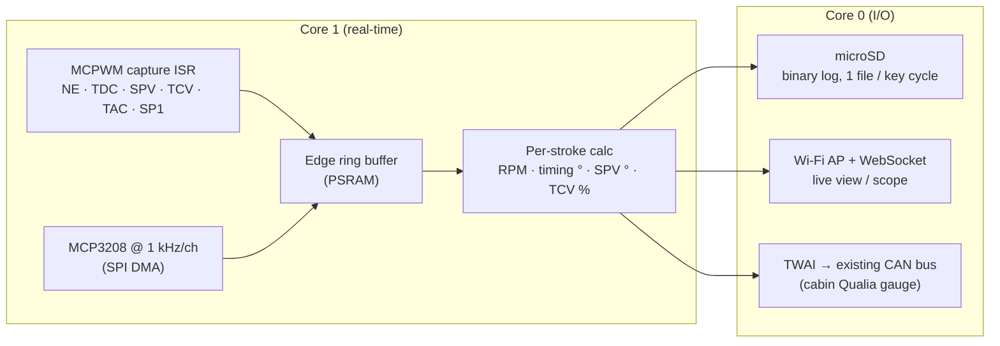

# ECU Tap Board: MCU and Logging Architecture

The electronics that ride on the [ECU interposer](../hardware/ecu_interposer/).
For background on the signals, see
[ECU_INTERPOSER_RESEARCH.md](ECU_INTERPOSER_RESEARCH.md).

## MCU choice: ESP32-S3

| Need | ESP32-S3 | ESP32-C3 (current engine-bay MCU) |
| --- | --- | --- |
| Hardware edge timestamping for NE, TDC, SPV, TCV, TAC, SP1 | **MCPWM capture: 2 units × 3 channels = 6**, on an 80 MHz timer (12.5 ns) | no MCPWM. It would need GPIO ISRs, which jitter by microseconds |
| Pulse counting | PCNT (4 units) | none |
| CPU | 2 cores: core 1 handles capture and ADC, core 0 handles Wi-Fi and SD | single core |
| Buffering | 8 MB PSRAM (N16R8) | none |
| CAN (TWAI), to join the existing bus | yes | yes |
| Native USB, for log dumps and flashing | yes | yes |

That makes six capture channels for exactly six timed signals, which settles
the choice.

- **Prototype:** ESP32-S3-DevKitC-1 (N16R8) or Seeed XIAO ESP32S3 on a
  perfboard tap shield.
- **Tap PCB:** ESP32-S3-WROOM-1-N16R8 module, with the PCB antenna at the
  board edge. The ECU sits behind the glovebox, so Wi-Fi reaches the cabin
  easily.

## Signal conditioning (tap classes)

Rule one: **the ECU must never see the tap.** Every tap has a series
resistor of **≥ 47 kΩ placed at the splice inside the interposer chamber**,
not on the tap board. Then even a shorted ribbon or a dead board can't load
an ECU line.

| Class | Signals | Front end |
| --- | --- | --- |
| **ANA** (0–5 V sensors) | VA, PIM, THW, THA, THF, VRP, VRT, VC | 1 MΩ series + rail-to-rail op-amp follower (MCP6004, 5 V) + RC (fc ≈ 1 kHz) → **MCP3208** 12-bit SPI ADC, 4.096 V ref. Never load the thermistor dividers. |
| **V-mon** (12 V rails) | +B, BATT, +BF, +BG | 100 k / 22 k divider + 5.1 V zener → MCP3208 |
| **VR** (variable reluctance) | NE±, TDC± | **MAX9926** dual VR interface: differential, adaptive threshold, high-Z → MCPWM capture |
| **CAP** (logic pulses) | TAC, SP1 | 100 k / 33 k divider + 74LVC1G17 Schmitt → MCPWM capture |
| **CAP-HV** (solenoid drives) | SPV, TCV | 220 k / 10 k divider + SMAJ5.0A TVS + Schmitt. Flyback on these lines can exceed 60 V. An optocoupler (6N137) is the more cautious option. |
| **DIG** (switches, lamps) | IDL, STA, A/C, W, G-IND, EGR, S/TH… | 100 k / 33 k + Schmitt → 74HC165 shift register (polled at 100 Hz) |

**Power** comes from **+B (E8-12)** through the interposer itself, with no
new feed to the battery: polyfuse 250 mA → TVS SMBJ24A → 12 V→3.3 V buck.
+B only goes live with the EFI main relay, so nothing drains with the key
off. **Ground** is E1 for the analog reference. The board's power return
also goes to E1, because the tap draws under 150 mA.

## Firmware data flow

### Derived channels (per pump stroke, 4 per crank revolution)

- **RPM:** from the TDC period.
- **Actual timing (°BTDC):** the phase of the NE tooth at the end of the
  pump-cam lobe relative to the TDC edge, minus a static offset that we
  calibrate once with a timing light or from the ECU's own value in
  diagnostic mode.
- **Injection quantity proxy:** SPV close→open duration converted to pump
  degrees using the NE tooth period.
- **Timing command:** TCV duty %.
- **Engineering units:** VA %, boost kPa, and coolant/IAT/fuel °C.

### Logging format

- Raw edges: `{u32 t_ticks, u8 channel, u8 level}`, 6 bytes each. At
  4,000 rpm that's about 25 k edges/s, ≈150 kB/s. An SD card handles this,
  and PSRAM absorbs write stalls.
- Analog frames at 100 Hz, plus per-stroke summary records.
- The summary records also go out as CSV over USB or Wi-Fi so they open
  directly in a spreadsheet or a log viewer.

### CAN integration (proposed, not yet in `shared/can_protocol.h`)

| ID | Payload |
| --- | --- |
| 0x110 | RPM (u16), actual timing ×10 (i16), TCV duty ×10 (u16) |
| 0x111 | SPV duration ° ×10 (u16), VA % ×10 (u16), boost kPa (u16) |
| 0x112 | THW, THA, THF °C (i16 ×3) |

This puts the tap box on the same bus as the engine-bay EGT/boost node, and
the cabin display gains RPM, timing and fuelling at no extra cost.

## Phase 2: piggyback interception (not built yet)

For PIM, VRP/VRT, THF and VA, the chamber gets a three-wire pigtail: ECU
side, harness side, and the tap. A **normally-closed** signal relay
(Panasonic TQ2) or an analog switch whose unpowered state is ON connects
ECU to harness. When the tap board is powered and armed, it switches the ECU
side over to a DAC or digital-pot output. Lose power, crash, or brown out,
and the line goes back to stock.

The project is **piggyback-only**: SPV and TCV are tap-only and are never
intercepted or driven (see research §4). The piggyback "maps" are
correction tables (e.g. PIM out = f(PIM in, RPM)) applied to sensor inputs.
The ECU's own maps still decide fuel and timing.
