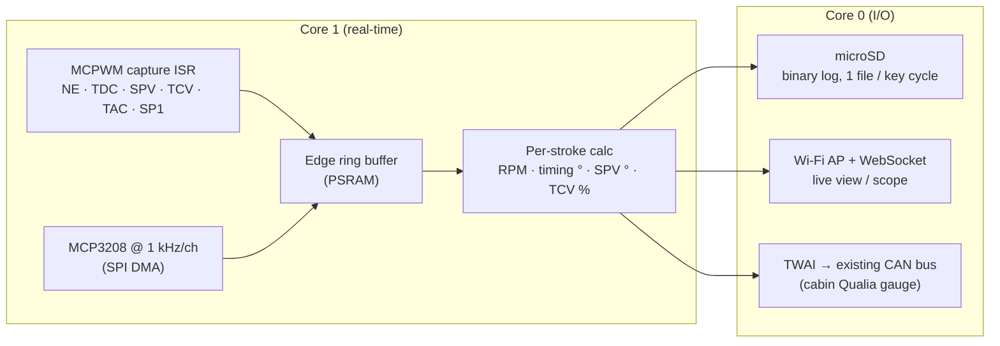

# ECU Tap Board: MCU and Logging Architecture

The electronics that ride on the [ECU interposer](../hardware/ecu_interposer/).
For background on the signals, see
[ECU_INTERPOSER_RESEARCH.md](ECU_INTERPOSER_RESEARCH.md).

## MCU choice: ESP32-S3

| Need | ESP32-S3 | ESP32-C3 (current engine-bay MCU) |
| --- | --- | --- |
| Hardware edge timestamping for NE, TDC, SPV, TCV, TAC, SP1 | **MCPWM capture: 2 units × 3 channels = 6**, on an 80 MHz timer (12.5 ns) | no MCPWM. It would need GPIO ISRs, which jitter by microseconds |
| Pulse counting | PCNT (4 units) | none |
| CPU | 2 cores: core 1 handles capture and ADC, core 0 handles Wi-Fi and SD | single core |
| Buffering | 8 MB PSRAM (N16R8) | none |
| CAN (TWAI), to join the existing bus | yes | yes |
| Native USB, for log dumps and flashing | yes | yes |

That makes six capture channels for exactly six timed signals, which settles
the choice.

- **Prototype:** Seeed XIAO ESP32S3 on a perfboard tap shield. The
  DevKitC-1 is too long for the tap box. The XIAO has fewer pins, so the
  prototype carries a subset of the front ends.
- **Tap PCB:** ESP32-S3-WROOM-1-N16R8 module, with the PCB antenna at the
  board edge. The ECU sits behind the glovebox, so Wi-Fi reaches the cabin
  easily.

## Signal conditioning (tap classes)

Rule one: **the ECU must never see the tap.** Every tap has a series
resistor of **≥ 47 kΩ placed at the splice inside the interposer chamber**,
not on the tap board. Then even a shorted ribbon or a dead board can't load
an ECU line.

All values include that 47 kΩ, and
[`kicad/tap/frontend_check.py`](../kicad/tap/frontend_check.py) checks
them. The net-by-net schematic is in [`kicad/tap/`](../kicad/tap/).

| Class | Signals | Front end (after the 47 kΩ splice) |
| --- | --- | --- |
| **ANA** (0–5 V sensors) | VA, PIM, THW, THA, THF, VRP, VRT, VC, THO | 100 k series, 10 M to AGND, MCP6004 follower at 5 V, then 3.3 k / 4.7 k + 100 nF (821 Hz) into an **MCP3208**. **Two MCP3208s** (11 channels, plus 5 Phase 2 readbacks), VDD 3.3 V, **REF3030 3.0 V reference**. The ECU line sees 10.15 MΩ. |
| **V-mon** | +B only | 56 k / 22 k + 100 nF → MCP3208. 16 V reads 2.86 V. **BATT is not tapped**: it is live with the key off and would back-feed the board through the input clamps. |
| **VR** (variable reluctance) | NE±, TDC±, SP2± | **MAX9926** ×2, dual VR interface: differential, adaptive threshold. NE and TDC → MCPWM capture, **SP2 → PCNT**. |
| **CAP** (logic pulses) | TAC, SP1 | 10 k series, 1 M to GND, BZX84C5V1 clamp, 22 pF → **74LVC14** (inputs 5.5 V tolerant, also unpowered) → MCPWM capture. |
| **CAP-HV** (solenoid drives) | SPV, TCV | Same network as CAP. The 47 kΩ + 10 kΩ limit a 60 V flyback to 1.1 mA into the zener. The old 220 k / 10 k divider could never reach the Schmitt threshold behind the 47 kΩ. |
| **DIG** (switches, lamps) | 31 lines | Same network as CAP → 74LVC14 → 4 × 74HC165, polled at 100 Hz. Reads low at 0.8 V or less and high at 4.5 V or more. |

**Power** comes from **+B (E8-12)** through the interposer itself, with no
new feed to the battery. The +B power lead takes a **500 mA PTC at the
splice** in place of the 47 kΩ. Then SS34 → SMBJ24A → Pololu D24V10F5
5 V buck → AP2112 3.3 V LDO. +B only goes live with the ECD main relay,
so nothing drains with the key off. The **power return is E01** (E5-13),
and the **analog reference is E2** (E6-9, sensor ground). They join on the
board at a single point under the ADC. The board draws about 200 mA from
+B at peak Wi-Fi, and about 270 mA with the Phase 2 relays armed.

## Firmware data flow

### Derived channels (per pump stroke, 4 per crank revolution)

- **RPM:** from the TDC period.
- **Actual timing (°BTDC):** the phase of the NE tooth at the end of the
  pump-cam lobe relative to the TDC edge, minus a static offset that we
  calibrate once with a timing light or from the ECU's own value in
  diagnostic mode.
- **Injection quantity proxy:** SPV close→open duration converted to pump
  degrees using the NE tooth period.
- **Timing command:** TCV duty %.
- **Engineering units:** VA %, boost kPa, and coolant/IAT/fuel °C.

### Logging format

- Raw edges: `{u32 t_ticks, u8 channel, u8 level}`, 6 bytes each. At
  4,000 rpm that's about 25 k edges/s, ≈150 kB/s. An SD card handles this,
  and PSRAM absorbs write stalls.
- Analog frames at 100 Hz, plus per-stroke summary records.
- The summary records also go out as CSV over USB or Wi-Fi so they open
  directly in a spreadsheet or a log viewer.

### CAN integration (in `shared/can_protocol.h`)

| ID | Payload |
| --- | --- |
| 0x110 | RPM (u16), actual timing ×10 (i16), TCV duty ×10 (u16) |
| 0x111 | SPV duration ° ×10 (u16), VA % ×10 (u16), PIM kPa absolute (u16) |
| 0x112 | THW, THA, THF, THO °C (i16 ×4) |

This puts the tap box on the same bus as the engine-bay EGT/boost node, and
the cabin display gains RPM, timing and fuelling at no extra cost.

## Phase 2: piggyback interception (not built yet)

For PIM, VRP/VRT, THF and VA, the chamber splits the line into a pigtail
pair, ECU side (E) and harness side (H), plus the usual 47 kΩ tap on H.
A **normally-closed** Panasonic TQ2-5V relay in the tap box connects E to
H. Both poles are paralleled. When armed, the relay switches E over to an
MCP4728 DAC output, buffered and fed through 1 kΩ. An on-board readback
of E lets the firmware close the loop on what the ECU actually sees.

The relay coil rail is on only while the firmware holds ARM high **and**
keeps toggling KICK from its control loop. A 74LVC1G123 retriggerable
one-shot drops the rail about 20 ms after the last toggle. Lose power,
crash, hang or brown out, and every line goes back to stock. The
earlier TPS3823 plan was dropped: after a hang, its reset pulse would
re-arm the relays for 1.6 s at a time.

One failure mode the relays can't cover: **unplugging the bypass
connector (J4) opens the intercepted lines.** Fit the shorted stock
jumper plug whenever the board is out.

The project is **piggyback-only**: SPV and TCV are tap-only and are never
intercepted or driven (see research §4). The piggyback "maps" are
correction tables (e.g. PIM out = f(PIM in, RPM)) applied to sensor inputs.
The ECU's own maps still decide fuel and timing.

## Cabin interface (direction, 2026-10-24)

- **Gauge:** the broken dash clock (a hole about 2–2.5 in across) is the
  candidate spot for a Qualia ESP32-S3 with a 2.1 in round 480 × 480
  display. It joins the existing CAN bus and shows the 0x110–0x112 data.
  It's always on and needs no phone. Measure the hole and the depth
  behind it before choosing the display.
- **Tuning and logs:** a web app served by the tap box over its own
  Wi-Fi, installable on a phone as a PWA. Nothing to publish in an app
  store, and every box gets it for free.
- **React Native:** deferred. Worth it only for background logging,
  Bluetooth, or a store listing. The web screens can be ported then.
- **Sensors, gauge pages and log channels:** see
  [SENSORS_GAUGE_LOGGING.md](SENSORS_GAUGE_LOGGING.md). It adds the
  pre-turbo EGT probe and a 3-bar MAP to the engine-bay node and extends
  the CAN IDs above with 0x103 and 0x113–0x115.
