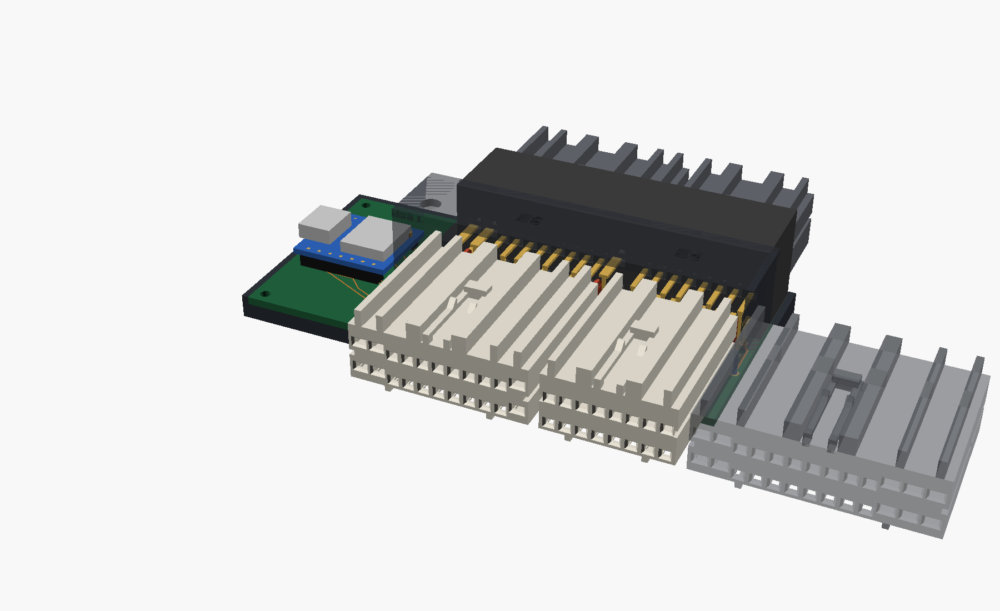
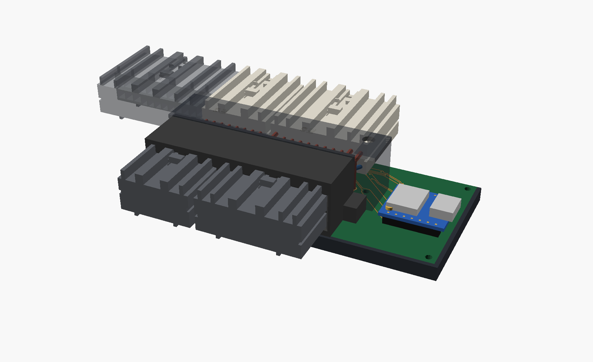
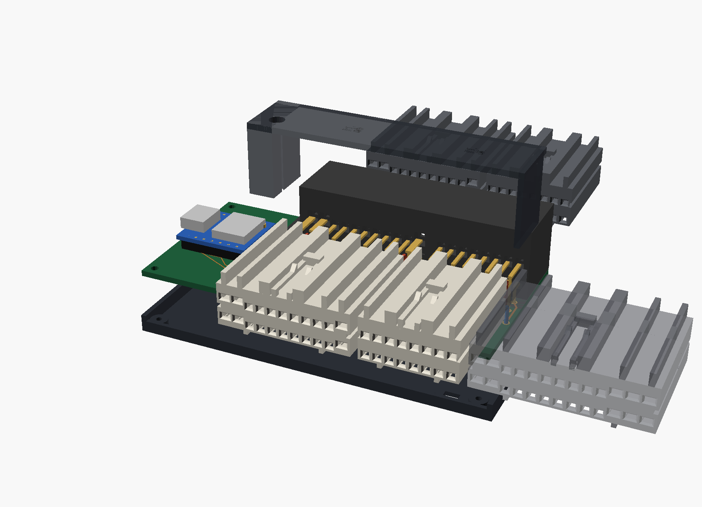
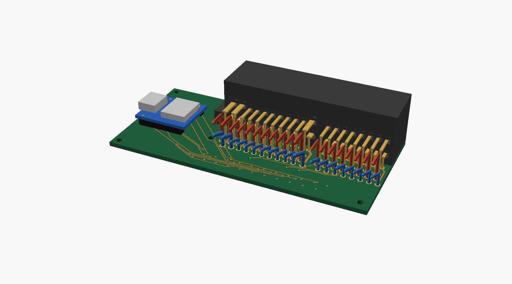

# PCB Interposer (proposal, rev B)

One small board that plugs in between the ECU and the E6 + E8 harness
plugs, with the ESP32 already on it. Plug it in, run a USB cable to a car
charger, done. It tucks behind the glovebox next to the ECU.

The board files are in [`kicad/interposer/`](../kicad/interposer/), and the
tray and lid are in
[`hardware/ecu_interposer/cad/pcb_interposer.scad`](../hardware/ecu_interposer/cad/pcb_interposer.scad).



## What the "spool" in the old render is

The grey box in the middle of each printed interposer is the **chamber**.
In that design every pin gets its own 40 mm wire: a crimped female
terminal on the ECU end and a crimped male tab on the harness end. The
chamber holds all of that coiled wire, plus the 12 tap splices with their
resistors. For E6 + E8 that is 38 wires, 76 crimps and 12 splices, and
two printed connector shells that have to hold OEM tolerances.

## The PCB version

```
 E6 + E8 harness plugs ==> TE 176122-6 header ==board== OEM female plugs ==> ECU
  (unchanged)              (sawn after E6)        │      (20 mm tails)
                                                  └─ 11 dividers ─▶ XIAO ESP32-S3 (on the board)
 E5 harness plug ======================================================> ECU (untouched)
```

- **Harness side:** a real **TE 176122-6**, the same right-angle header
  the ECU uses (about $10 to $14, in production), sawn off after the E6
  section. The harness plugs click into genuine TE plastic with the real
  latch, so the FDM/SLS mating tolerance question goes away.
- **ECU side:** nobody sells a board-mount female for these terminals, so
  the board takes the two OEM female plugs on short tails. The easiest
  source is a junkyard Toyota ECU harness: cut the E6 and E8 plugs off
  with 25 mm of wire and solder the wires in. Nothing printed goes into
  the ECU.
- **Taps and ESP32:** both divider resistors for every channel and a
  Seeed XIAO ESP32-S3 sit on the board. No tap box, no Dupont leads. The
  XIAO's USB-C sticks out of the end for power and flashing, and its
  antenna lead comes out the same end.
- **E5 isn't touched.** Its plug stays in the ECU as it is now.

| Harness side | Exploded |
| --- | --- |
|  |  |



## Why there are so many traces

38 of them are the pass-throughs: every E6 and E8 pin has to reach the
ECU, so each header pin gets one short straight trace to its tail pad.
That's the same 38 wires the printed version had, just flat. The other 22
are the taps: 11 pins to their divider and 11 dividers to the XIAO.

## Compared with the printed interposer

| | Printed (E6 + E8) | PCB rev B (E6 + E8) |
| --- | --- | --- |
| Mating plastic, harness side | printed copy of the header | **real TE 176122-6** |
| Mating plastic, ECU side | printed plug, resin | **OEM plugs** (junkyard or TE) |
| Crimps and splices | 76 crimps, 12 splices | 0 crimps with junkyard plugs, 76 solder joints |
| ESP32 | DevKitC in a separate box on Dupont leads | **XIAO soldered on the board** |
| Size | two stacks about 60 mm long, plus a tap box | one 97 × 46 × 24 mm board in a tray |
| Harness plugs move back by | about 60 mm | about **51 mm** |
| Rough cost | $158 print quote + terminals + DevKitC | **about $55 to $95** |

Cost: board about $10 to $25 for five from JLCPCB (2 oz copper) plus
shipping. Header $10 to $14. Junkyard pigtail $20 to $40. XIAO ESP32-S3
about $8. Resistors $3. Tray and lid printed at home in PETG, or about
$15 to $25 in SLS PA12.

## What it costs, honestly

- **E2 isn't tapped.** The XIAO has 11 GPIO and there are 12 stage 1
  channels, so E2 (sensor ground) went. Sensor readings use the XIAO's
  ground as the reference, which costs a little accuracy if E2 floats
  above chassis ground. A board revision with a bigger ESP32 module could
  bring it back.
- **The header has to be sawn.** One cut through a 1.48 mm wall, with the
  E5 pins pulled first. Done carefully it leaves the E6 cavity whole.
- **Power pins.** The 070 pins in E6/E8 carry ECU power and grounds. Their
  traces are 1.4 mm on both layers where there's room, and 0.5 to 0.8 mm
  per layer for a few mm where they pass between pads. With 2 oz copper
  that's fine for the ECU's few amps.
- **76 solder joints on wires the engine needs.** Each one gets a
  continuity check before the engine starts.
- **The ECU-side plugs float on their tails.** That's on purpose: each
  plug finds its own cavity in the ECU, the way a harness plug does.
- **Depth.** It's still about 51 mm. Most of that is the two plastic
  connectors, which are OEM size. The harness needs about 5 cm of slack,
  the same as before.

## Open checks before ordering

1. Check the 176122-6 pad numbering against a real header with a meter
   (see [`kicad/interposer/README.md`](../kicad/interposer/README.md)).
2. Measure an OEM plug's length and the ECU face around the header. The
   board stops about 4 mm short of the header mouth.
3. Check the XIAO footprint against the Seeed drawing.
4. Choose where the ECU-side plugs come from: a junkyard pigtail
   (recommended) or new TE housings plus 38 receptacles.

Side view, harness on the left and ECU on the right:


