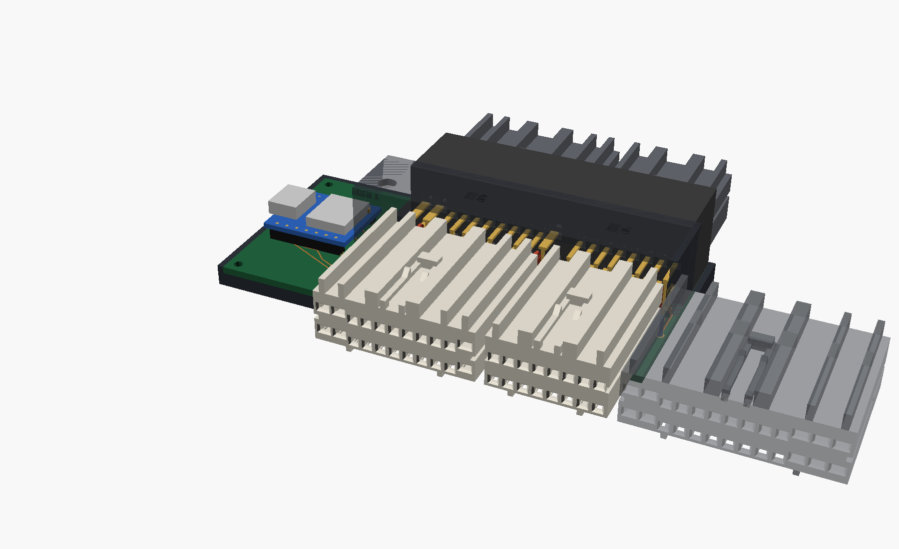

# Build Guide: KZJ95 ECU Tap Board (rev C)

Solder it on the bench, plug it in between the ECU and its three harness
plugs, plug a USB-C cable into it. Nothing in the truck gets cut.

**Time:** about 4 to 5 hours at the bench. **Tools:** soldering iron (a fine
tip and a chisel tip for the big pins), 60/40 or SAC solder, flux,
side cutters, an open-barrel crimper, multimeter, a USB-C car charger (2 A) and a cable.

## 1. Get the parts

Everything is in the BOM. Three things to sort first:

1. **Order the board.** Upload `kicad/interposer/gerbers/` (zipped) to
   JLCPCB or PCBWay: 2 layers, 1.6 mm, **2 oz copper**, HASL. Five boards
   are about $15 to $30.
2. **Order the ECU-side plug parts** (all in the BOM): TE housings
   175110-6 (E8), 175109-6 (E6) and 175111-x (E5), 48 small (040) and 16
   big (070) receptacles, 22 and 18 AWG wire. Before ordering, read the
   part number moulded on each of your truck's three harness plugs: the
   ECU-side plugs are the same housings, and the last digit sets the key.
3. **Print the tray and lid** (`pcb_tray.stl`, `pcb_lid.stl`) in PETG at
   home, or SLS PA12.

## 2. Check the board before soldering anything

1. Lay the bare board on the paper copy of `kicad/interposer/img/board_top.png`
   and sit the header and the DevKitC on it. The pins should line up with
   the holes.
2. **Pad numbering check** (one time): with the meter in continuity mode,
   probe an E8 header pin and find which tail pad it reaches on the bare
   board. It should match the pin numbers printed on the silkscreen.

## 3. Solder the back (resistors)

All resistors go on the **back** of the board. The values are printed
next to each pair.

| Position | Value | Qty |
| --- | --- | --- |
| Top of every pair (R1 to R17) | 100k | 17 |
| PIM, THW, THA, THF, THO, VA, VC, E2 | 82k | 8 |
| +B | 18k | 1 |
| W, TAC, SL, S1, S2, L4, TFN | 27k | 7 |
| SP1 | 150k | 1 |

Leave the 10 nF caps off unless an analog channel turns out noisy later.

## 4. Solder the header (J1)

1. Push the 176122-6 into the board from the top until its pegs seat and
   the body sits flat.
2. Solder the four corner pins first, check it's still flat, then do the
   rest. The big 070 pins (power, grounds, SPV, TCV) need the chisel tip
   and a few seconds each: the 2 oz copper pulls heat away.
3. Trim the leads on the back to about 1.5 mm so the board sits flat in
   the tray.

## 5. Make the ECU-side plugs and solder them on (J2, J3, J4)

The long, flexible tails are what let the board sit exactly where the
ECU's header is now, so your stiff harness never has to bend or reach.

1. **Cut 64 tails, 150 mm each:** 48 in 22 AWG for the small pins, 16 in
   18 AWG for the big pins (E8 columns 1, 2 and 11; E5 columns 1, 2, 11,
   12 and 13, both rows).
2. **Crimp a receptacle on one end** of each: 175061-1 on the 22 AWG,
   173631-1 on the 18 AWG. Tug-test every crimp.
3. **Load each housing** from the wire side, pin 1 first, until each
   receptacle clicks. Pin N of the plug goes to the tail pad marked N on
   the board, so work one column at a time and solder as you go.
4. **Solder the free ends** into the board: strip 3 mm, the plug's pin 1
   goes to the square pad of its row. Upper-row wires go to the row
   nearer the header, lower-row wires to the row nearer the ECU edge.
5. **Sleeve each plug's tails** in braided sleeve so the three plugs hang
   off the board's ECU edge on 150 mm of flexible wire.

## 6. Solder the DevKitC (U1)

1. Solder the DevKitC's pin headers into the L-shaped end, antenna toward
   the ECU edge, USB toward the harness side (the silkscreen shows both).
2. Don't put anything metal under the antenna end.

## 7. Test on the bench (before it goes near the truck)

1. **Every pass-through:** meter in continuity mode, from each header pin
   to the matching pin face inside the ECU-side plug. All 64 must beep. Any
   that don't, reflow.
2. **No shorts:** check each pin against its neighbors, and power pins
   against ground pins.
3. **TAP_GND is isolated:** the DevKitC's GND must not beep to any ECU
   ground pin (E1, E01, E02, E03, E2).
4. **Power the DevKitC from USB** and flash the tap firmware. With nothing
   plugged in, every channel should read about 0 V.

## 8. Fit it in the truck

1. Battery negative off.
2. Behind the glovebox: unplug the E5, E6 and E8 plugs from the ECU, and
   unbolt the ECU from its bracket.
3. Screw the board into the tray and put the lid on (the long screw next
   to E8 holds it).
4. Plug the three harness plugs into the board's header until they click.
   The board sits where the ECU's header was, so the loom doesn't move.
5. Move the ECU back or to the side by about 5 cm, plug the board's three
   tail plugs into it until they click, and zip-tie the ECU and the tray
   to the bracket.
6. Run a USB-C cable from the DevKitC to a car charger. Use a switched
   (ignition) socket, so the tap sleeps when the truck does.
7. Battery back on. Key on, engine off: check the dash lights come up as
   normal. Start the engine.

If anything is wrong, unplug the board and put the original plugs back:
the truck is exactly stock again.

## What it reads

| Signal | From | What you get |
| --- | --- | --- |
| PIM | E6-2 | boost |
| THW, THA, THF, THO | E6-4, 3, 5, 13 | coolant, intake air, fuel and ATF temps |
| VA | E6-11 | pedal |
| VC, E2 | E6-1, 9 | sensor reference and ground, for accurate readings |
| +B | E8-12 | battery volts |
| W | E8-5 | check-engine light, and the codes it flashes |
| TAC | E8-18 | rpm |
| SP1 | E8-9 | road speed |
| S1, S2 | E5-2, 15 | gear |
| SL | E5-1 | torque converter lock-up |
| L4, TFN | E5-7, 8 | low range, transfer neutral |
