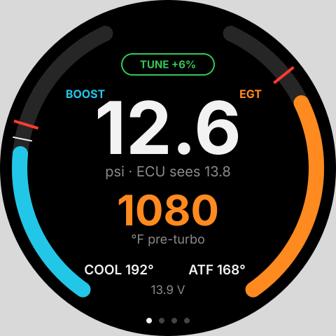
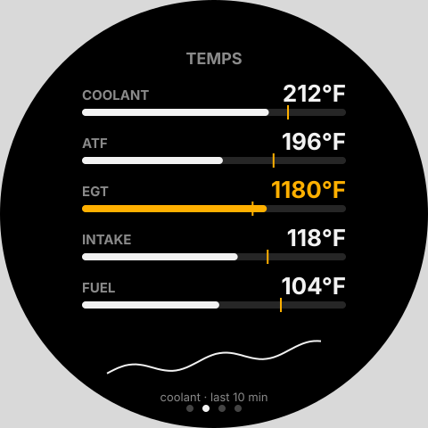
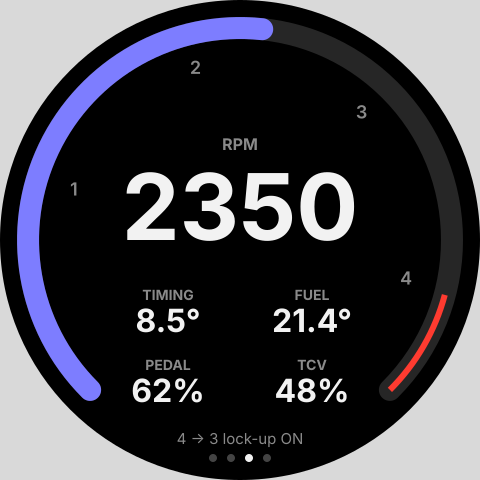
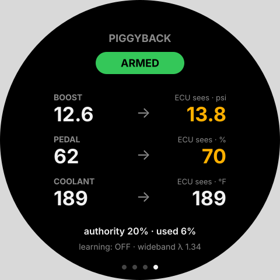
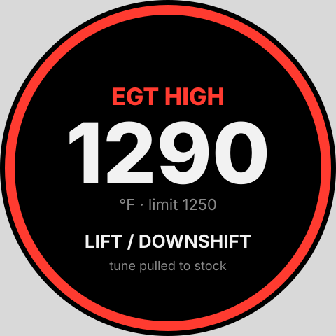

# Added Sensors, Gauge Screens and Logging

What the truck gains on top of the [ECU tap](ECU_TAP_ARCHITECTURE.md):
which extra sensors to fit, what the round dash gauge shows, and what gets
logged. Scope is unchanged: **piggyback only**. We read everything and
reshape only PIM, VA, THW (later maybe THA). SPV and TCV are never touched.

## 1. Where every number comes from

Most of what we want to see is already on the ECU harness, so the tap reads
it for free. Only two things need new hardware.

| Quantity | Source | New hardware? |
| --- | --- | --- |
| Boost (what the stock sensor says) | PIM, tap H side (E6-2) | no |
| Boost (what the ECU is told) | PIM, E side readback (Phase 2) | no |
| Coolant, intake air, fuel, ATF temp | THW, THA, THF, THO (E6) | no |
| Pedal, idle switch | VA, IDL (E6) | no |
| RPM, injection timing, injection quantity, TCV duty | TDC, NE, SPV, TCV edges | no |
| Vehicle speed | SP1 (E8-9), SP2 (E5) | no |
| Battery / system voltage | +B (E8-12) | no |
| Glow, starter, check-engine lamp, A/C, lock-up, gear switches | DIG lines | no |
| **Exhaust gas temperature** | K-type probe on the engine-bay node | **yes** |
| **Independent boost** (absolute) and baro | 3-bar MAP on the engine-bay node | **yes** |
| λ (optional, later) | LSU 4.9 wideband controller on CAN | optional |

That's also why the coolant NTC on the engine-bay node is now dropped: THW
from the ECU's own sensor is better than a second sensor we'd have to drill
into the block for.

> **Direction check on the boost lever.** Telling the ECU *more* boost than
> there is lets the smoke limiter add fuel. Telling it *less* keeps a raised
> boost under the ~15 psi fuel cut. (An earlier chat summary had this the
> wrong way round; [LEARNING_TUNER.md](LEARNING_TUNER.md) §1 is right.)

## 2. EGT probe

EGT is the one gauge a turbo diesel really needs, and the tuner's authority
depends on it (one of EGT/wideband = 8 % extra fuel, both = 20 %, neither = 0).

### Part

| Item | Pick | Why |
| --- | --- | --- |
| Probe | K-type, **ungrounded (isolated) junction**, 1/8" NPT compression fitting, 1/4" (6 mm) Inconel sheath, exposed or open tip, 2 in insertion | The MAX31855 needs the thermocouple isolated from chassis. A grounded tip, bolted into the manifold, shorts to engine ground and reads as a fault. Open tip is fast (~1 s); a closed 1/4" tip lags 3 to 5 s. |
| Lead | Fiberglass or stainless braid K-type extension, 1–1.5 m, to the engine-bay node | Must be K-type alloy all the way to the MAX31855 terminal; copper in between creates a false junction. |
| Amp | MAX31855K (already on the engine-bay node) | Already in the BOM and firmware. |

Avoid the cheap "EGT probe kits" with a fixed molded lead; replaceable
compression-fitting probes are what you want if one cracks.

### Where it goes

**Pre-turbo, in the exhaust manifold collector**, as close to the turbine
inlet flange as there's a flat boss, roughly 2 in (50 mm) upstream. That's
where turbo-killing heat shows first, and it's where the common diesel
limits are quoted. Post-turbo reads 200–300 °F lower, lags, and makes it
hard to compare against anyone else's numbers.

How: pull the manifold (or at least the turbo) so no swarf can reach the
turbine, drill 11/32" (8.7 mm) and tap 1/8"-27 NPT, then blow it out. Set
the tip in the center of the gas stream. Route the lead away from the
downpipe and clip it every ~6 in.

Fallback if pulling the manifold is too much: a weld-in 1/8" NPT bung in the
downpipe within 3 in of the turbine outlet. Mark the gauge "post-turbo" and
lower every limit by 250 °F.

[MEASURE] on the truck: whether the manifold collector has a flat boss, and
heat-shield clearance for the compression fitting.

### Limits (pre-turbo)

| Level | °F | °C | Action |
| --- | --- | --- | --- |
| Normal cruise | < 900 | < 480 | — |
| Warn (amber) | 1150 | 620 | Gauge goes amber. |
| Hard limit (red) | 1250 | 675 | Alert overlay, tuner pulls PIM back to stock. |
| Tuner model ceiling | 1290 | 700 | Matches `LEARNING_TUNER.md`. Never sustained. |

These sit below the usual "1300 °F pre-turbo" diesel rule of thumb on
purpose: the 1KZ-TE is known for cracking heads when run hot.

## 3. Independent boost sensor

### Is it worth it?

Yes, but cheaply. The stock PIM sensor already gives true boost on the
harness side, so a second sensor isn't needed to see boost. It earns its
place for three reasons:

1. **Cross-check.** When the piggyback is armed, real boost, the stock
   sensor and what the ECU is told should agree in a known way. If the stock
   sensor drifts or the relay sticks, the third reading catches it.
2. **Barometric pressure.** An absolute sensor read at key-on gives baro,
   which the tuner uses as a table axis. Without it baro is estimated from
   PIM.
3. **Range.** The stock sensor tops out somewhere around the ECU's ~15 psi
   fuel cut [MEASURE: stock PIM voltage at a known boost]. A 3-bar sensor
   sees overboost beyond the cut.

### Part

**GM 3-bar MAP** (12569240 or 16254609), already listed in
[BENCH_TESTING.md](BENCH_TESTING.md) Stage 6: 5 V supply, ~0.4–4.7 V over
roughly 0–43 psi absolute. It plugs straight into the existing J3 input
(5 V, signal, ground) on the engine-bay node, through its 2:1 divider into
ADS1115 A1.

Firmware change: it's an **absolute** sensor, so `read_map_psi_x10()` needs
the datasheet transfer curve (not the current 0.2–4.7 V = 0–29 psi gauge
line) and subtracts the baro reading latched at key-on, before cranking.

### Where it goes

- Sensor on the **firewall or inner fender**, not on the engine (vibration),
  port facing down so condensation drains.
- Hose: tee into the existing hose from the intake manifold to the stock PIM
  sensor with a 1/8" (3–4 mm) barbed tee. No drilling, fully reversible,
  and both sensors then see the same point. Keep the new branch under 3 ft.
- Optional later: a second tap pre-intercooler (if the truck has one)
  shows intercooler pressure drop. Not worth it on day one.

## 4. Engine-bay node changes

The node (ESP32-C3 + MAX31855 + ADS1115, see
[kicad/engine_bay](../kicad/engine_bay/schematic.md)) needs very little.

| Channel | Today | After |
| --- | --- | --- |
| MAX31855 | EGT | EGT (pre-turbo, ungrounded probe) |
| ADS1115 A0 | Coolant NTC (J2) | **Freed.** Coolant comes from THW via the tap. Leave J2 fitted for a future oil-temp or oil-pressure sender. |
| ADS1115 A1 | MAP (J3, 2:1 divider) | 3-bar absolute MAP, same wiring |
| ADS1115 A2 | NC | Spare (oil pressure, 0.5–4.5 V sender, through the same 2:1 divider) |
| ADS1115 A3 | NC | **+5 V sensor supply monitor** through a 2:1 divider, so the MAP reading can be made ratiometric |

No new MCU pins, no new board. The tap board's ADC plan doesn't change
either: every ECU sensor is already on its two MCP3208s.

### Wiring and the CAN bus

Three nodes now share one bus at 500 kbit/s:

```
engine-bay node ── firewall grommet ── tap box (behind glovebox) ── dash ── gauge (clock hole)
   120 Ω on                              no termination,                    120 Ω on
                                         stub ≤ 0.3 m                       (+ wideband later, no term.)
```

- Terminate only the two physical ends: the engine-bay node and the gauge.
  The tap box leaves JP1 open.
- One twisted pair (CAN_H/CAN_L) daisy-chained, plus ground. The tap box is
  powered from +B through the interposer; it does not take the bus's 12 V.
- **Gauge power:** the dead clock's own connector very likely carries
  +B (memory), ACC/IG, illumination (TAIL) and ground. Feeding the gauge from
  it means no new power wire, and TAIL gives night dimming for free.
  [MEASURE] the clock connector pins against the EWD before using it.

### CAN IDs

Keep the existing engine-bay frames so nothing breaks, and add the rest.
All multi-byte values big-endian, `INT16_MIN` = invalid.

| ID | From | Rate | Payload |
| --- | --- | --- | --- |
| 0x100 | engine-bay | 20 Hz | EGT °F (i16) *(existing)* |
| 0x101 | engine-bay | 20 Hz | ~~coolant~~ retired; gauge uses 0x112 |
| 0x102 | engine-bay | 20 Hz | MAP gauge psi ×10 (i16) *(existing)* |
| 0x103 | engine-bay | 2 Hz | MAP abs kPa ×10 (u16), baro kPa ×10 (u16), 5 V rail mV (u16), aux A2 mV (u16) |
| 0x110 | tap | 50 Hz | RPM (u16), timing °BTDC ×10 (i16), TCV duty ×10 (u16) *(from the tap doc)* |
| 0x111 | tap | 50 Hz | SPV ° ×10 (u16), VA % ×10 (u16), PIM boost kPa (u16) *(from the tap doc)* |
| 0x112 | tap | 5 Hz | THW, THA, THF °C (i16 ×3), THO °C (i16) |
| 0x113 | tap | 10 Hz | piggyback: armed (u8), PIM seen kPa (u16), VA seen % ×10 (u16), THW seen °C (i16), extra fuel % (u8) |
| 0x114 | tap | 5 Hz | +B mV (u16), speed km/h ×10 (u16), DIG bits (u32: W lamp, glow, STA, lock-up, A/C, gear switches) |
| 0x115 | tap | on change | alert code (u8), value (i16), limit (i16) |
| 0x190 | wideband | 50 Hz | λ (rusEFI-style controller, optional) |

The gauge works in whatever units it likes; the bus stays in kPa/°C for
everything new. The old 0x100/0x102 °F/psi frames stay as they are.

## 5. Gauge screens

Hardware: Adafruit Qualia ESP32-S3 + 2.1" round 480 × 480 RGB TTL display
(TL021WVC02, PID 5806 no touch or 5792 touch) in the clock hole. Note the
Qualia drives the panel over parallel RGB, not SPI, so
[`src/cabin/main.cpp`](../src/cabin/main.cpp) (which uses an ST7789 SPI
driver) has to move to the Arduino_GFX RGB panel driver before any of this
runs.

**Input.** Don't rely on touch at arm's length on a bumpy trail. One
momentary button cycles pages (long-press = back to Drive). If the clock's
H/M adjust buttons survive in the bezel, reuse them. Alerts take over any
page automatically and clear when the value drops back below the warn level
plus some hysteresis.

**Units.** °F and psi on the gauge by default, switchable in the PWA.

Mockups (made-up example values; regenerate with
`python3 docs/gauge/mockups.py`):

| | |
| --- | --- |
|  |  |
| **1. Drive** (default) | **2. Temps** (towing, climbing) |
|  |  |
| **3. Engine** | **4. Tune** |
|  | |
| **Alert** (overlays any page) | |

1. **Drive.** Split ring: boost on the left (0–25 psi, red tick at the
   ~15 psi fuel cut, white tick at what the ECU is being told), EGT on the
   right (0–1600 °F, red tick at the hard limit). Center: boost big, EGT
   below. Footer: coolant, ATF, volts. The pill at the top shows tune state:
   STOCK (grey), TUNE +n % (green), LEARNING (blue).
2. **Temps.** Coolant, ATF (THO), EGT, intake (THA), fuel (THF) as bars with
   their warn tick, plus a 10-minute coolant trend, because the trend on a
   long climb is what tells you to back off before the needle does.
3. **Engine.** RPM ring (red from 4000), injection timing °BTDC, injection
   quantity (spill-valve degrees), pedal %, TCV duty, and lock-up state.
4. **Tune.** Armed or bypassed, then each faked signal as real → what the
   ECU sees (amber when they differ), the authority the fitted sensors allow,
   how much is in use, and learner state.

**Alerts** (in priority order):

| Alert | Trigger | Tuner action |
| --- | --- | --- |
| EGT HIGH | ≥ 1250 °F pre-turbo for 2 s | pull PIM to stock |
| COOLANT HIGH | THW ≥ 230 °F (110 °C) | pull PIM to stock, THW lever off |
| OVERBOOST | real boost ≥ 17 psi | pull PIM to stock (the ECU will cut anyway) |
| ATF HIGH | THO ≥ 260 °F | none; just tells you |
| CHECK ENGINE | W lamp (E8-5) turns on | log it; show until acknowledged |
| LOW VOLTS | +B < 12.4 V with engine running for 10 s | none |
| BUS LOST | no 0x110 for 1 s | gauge shows dashes; tap reverts to stock on its own |

Amber warn levels: EGT 1150 °F, coolant 221 °F (105 °C), ATF 230 °F,
boost 15 psi.

## 6. What gets logged

The tap writes to microSD, one file per key cycle, as described in the tap
doc (raw edges + 100 Hz analog frames + per-stroke summaries). The engine-bay
data reaches the tap over CAN and is logged with the same timestamps, so
everything lands in one file.

### Channels

| Channel | Unit | Source | Log rate | Gauge | PWA live |
| --- | --- | --- | --- | --- | --- |
| rpm | rpm | TDC period | per stroke | Engine | yes |
| timing | °BTDC | NE vs TDC | per stroke | Engine | yes |
| inj_qty | ° pump | SPV close→open | per stroke | Engine | yes |
| tcv_duty | % | TCV | per stroke | Engine | yes |
| pim_real | kPa | PIM, H side | 100 Hz | Drive | yes |
| pim_seen | kPa | PIM, E readback | 100 Hz | Drive, Tune | yes |
| map_abs | kPa | 3-bar MAP | 20 Hz | — | yes |
| baro | kPa | MAP at key-on | per cycle | — | yes |
| egt | °C | MAX31855 | 20 Hz | Drive, Temps | yes |
| va_real / va_seen | % | VA H / E | 100 Hz | Engine, Tune | yes |
| idl | bool | IDL | 100 Hz | — | — |
| thw_real / thw_seen | °C | THW H / E | 10 Hz | Drive, Temps | yes |
| tha | °C | THA | 10 Hz | Temps | yes |
| thf | °C | THF | 10 Hz | Temps | — |
| tho | °C | THO | 10 Hz | Drive, Temps | yes |
| vbat | V | +B | 100 Hz, **1 kHz while STA** | Drive | yes |
| speed | km/h | SP1 | 10 Hz | — | yes |
| sp2_rpm | rpm | SP2 (A/T output) | 10 Hz | — | — |
| lockup, s1, s2 | bool | SL, S1, S2 | on change | Engine | — |
| gear_sw | enum | NSW, 2, L, P, OD2 | on change | — | — |
| glow_ind, glow_relay | bool | G-IND, S-REL | on change | — | — |
| sta, a/c, a/c cut, stop | bool | STA, A/C, ACT, STP | on change | — | — |
| w_lamp | bool | W | on change | Alert | yes |
| lambda | λ | wideband (optional) | 50 Hz | Tune | yes |
| pb_armed, pb_extra_fuel | bool, % | tap firmware | on change, 10 Hz | Drive, Tune | yes |
| alert | code | gauge/tap | on change | Alert | yes |

### Events (one row each, in a separate `events.csv`)

These turn the raw channels into the things worth looking at later.

| Event | Recorded |
| --- | --- |
| Crank | start and end time, min vbat, cranking rpm, glow time before crank, THW at start |
| Warm-up | key-on to THW 70 °C and to 80 °C, ambient (THA at start) |
| Boost run | each pull above 50 % pedal: rpm at which boost reached 5 / 10 psi (spool), peak boost, peak EGT, time above EGT warn |
| Heat soak | each interval with EGT > warn or THW > warn: duration, peak, speed, gear |
| Check engine | W lamp on/off time and what was happening |
| Shift | each lock-up on/off and S1/S2 change, with rpm and speed |
| Alert | every alert with its value and limit |

### Analyses the PWA can build from that

- **Real vs ECU boost:** pim_real against pim_seen and map_abs, to see the
  piggyback is doing what the table says and that the sensors agree.
- **Tune safety:** EGT against boost and pedal, scatter by rpm, with the
  limits drawn in.
- **Warm-up and towing:** the warm-up times per start, and the coolant/ATF
  trends on long climbs.
- **Turbo/intercooler health:** boost against rpm at full pedal, compared run
  to run. A slowly rising spool rpm means a sticky wastegate, a leak or a
  tired turbo.
- **Battery and glow:** min cranking volts and glow time per start; a
  downward trend shows a weak battery or a dead glow plug before it strands
  you.

### Trouble codes

The 1KZ-TE is OBD1: codes come out as check-engine lamp flashes with TE1
shorted to E1. We log the W lamp live, but reading actual codes means
grounding TE1, which changes ECU behaviour, so it must never happen while
driving. Plan: a "Read codes" button in the PWA, **key on, engine off
only**, that closes a small relay TE1→E1 for 20 s while the tap decodes the
W-lamp flash pattern. TE1 (E6-15) isn't tapped today, so this is a small
interposer addition for later. The VF output (E6-8, already tapped) may also
carry diagnostic data; worth a look once there are logs.

## 7. Shopping list and order of work

| Item | Approx. $ |
| --- | --- |
| K-type ungrounded probe, 1/8" NPT compression, 1/4" Inconel, open tip | 25–60 |
| K-type braided extension lead, 1.5 m, with mini-K plug | 10–15 |
| 1/8"-27 NPT tap + 11/32" drill (or weld-in bung for post-turbo) | 15 |
| GM 3-bar MAP (12569240 / 16254609) + pigtail | 25–45 |
| 1/8" barbed tee + 3 ft vacuum hose | 5 |
| Adafruit 2.1" round display (5806 or 5792) + Qualia ESP32-S3 | 60–80 |
| Momentary pushbutton (if the clock buttons are gone) | 3 |

1. **Log first, no tune.** Fit the EGT probe and MAP sensor, flash the
   engine-bay changes, and log a week of normal driving with the piggyback
   bypassed. This gives the baseline every later comparison needs.
2. **Gauge on the bench**, driven from a recorded log replayed onto CAN.
3. **Gauge in the dash**, once the clock-hole size and depth are measured.
4. **Piggyback armed**, Drive and Tune pages showing real vs seen.
5. Wideband (optional), then the TE1 code-reader relay.

## Open items to measure

- Manifold collector: flat boss for the EGT bung and heat-shield clearance.
- Stock PIM sensor voltage at a known boost (its top of range).
- Whether the truck has an intercooler (decides if a pre-IC tap makes sense).
- Clock hole diameter, depth behind it, and the clock connector pinout.
