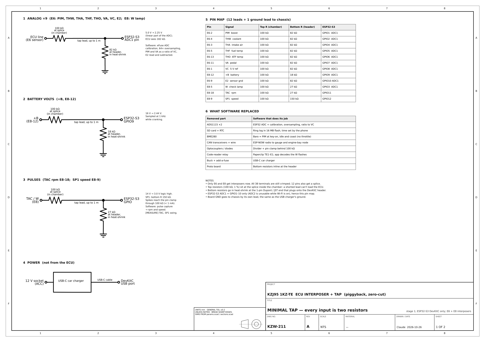
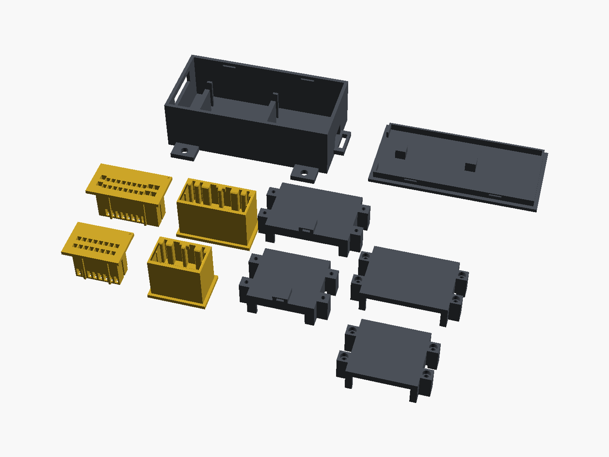
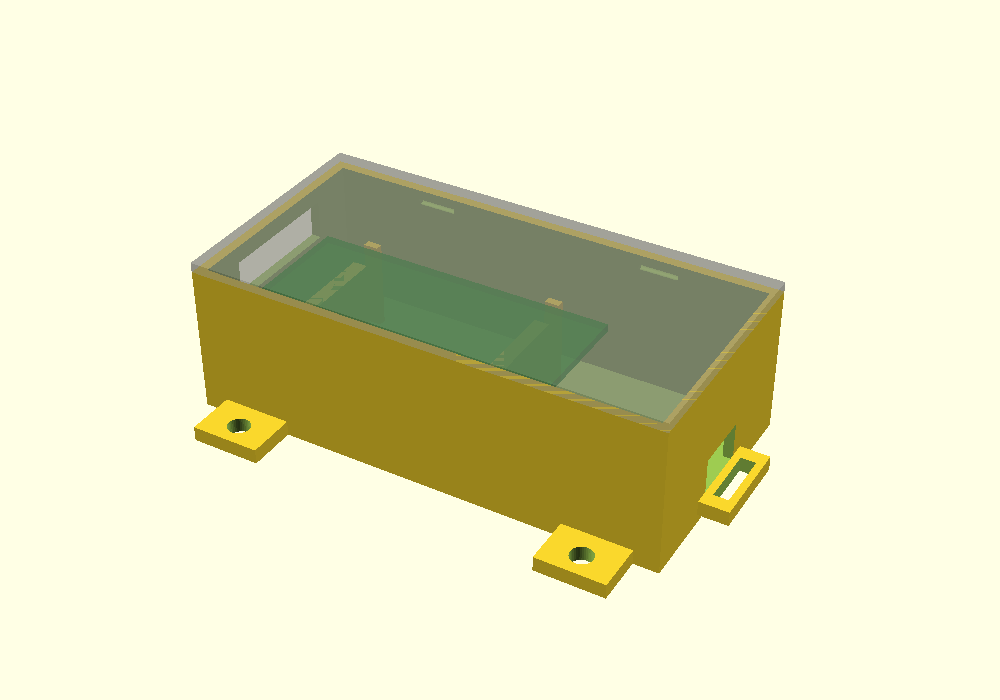
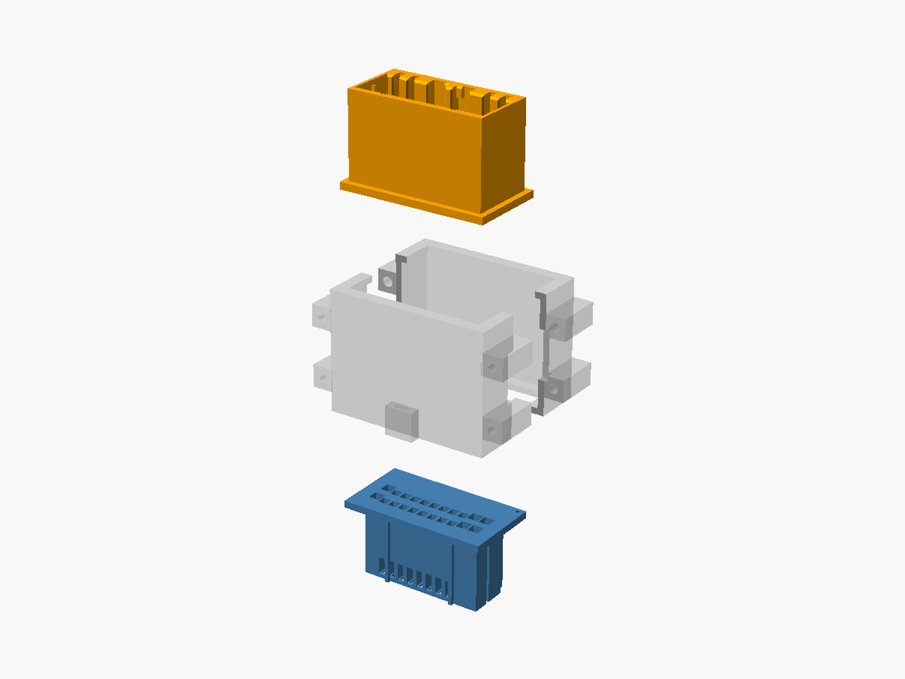

# Stage 1 Tap Box: Build Guide

Read twelve sensor wires off a 1996 Toyota 1KZ-TE ECU (KZJ95 Prado,
automatic) without cutting the harness, and show boost, temps, rpm, speed,
volts, check-engine codes, baro and logs on your phone.

The build is one ESP32-S3-DevKitC-1, 24 resistors, two printed
interposers that plug in between the ECU and its E6 and E8 plugs, and a
small printed box. There's no PCB. Software does the rest (see
[BUILD_STAGES.md](BUILD_STAGES.md)).

*Amber parts are Tough Resin; grey parts are SLS PA12.*

## 1. Printed parts and materials

| Part | Qty | Material | Why |
| --- | --- | --- | --- |
| E6 16-pin female plug | 1 | **Tough Resin (SLA)**, standard finish | Holds the receptacles. Walls between cavities are 0.35 mm, the same as OEM. SLA resolves that, and MJF/SLS (0.8 mm minimum) may not. |
| E6 16-pin male shroud | 1 | **Tough Resin (SLA)** | Holds the tabs, and the OEM plug latches into it. Same thin walls. |
| E8 22-pin female plug | 1 | **Tough Resin (SLA)** | As E6. Its two latch tines flex, so use a tough/ABS-like resin, not standard resin. |
| E8 22-pin male shroud | 1 | **Tough Resin (SLA)** | As E6. |
| E6 chamber, bottom + top | 1 each | **SLS Nylon PA12**, standard (or PETG/ASA on your own FDM printer) | Only a shell around the pigtails, so it isn't critical. PA12 is fine at cabin temperatures. |
| E8 chamber, bottom + top | 1 each | **SLS Nylon PA12** (or PETG/ASA FDM) | As above. |
| Tap box base | 1 | **SLS Nylon PA12** (or PETG/ASA FDM) | Holds the DevKitC. Plastic only, so the Wi-Fi antenna isn't shielded. |
| Tap box snap lid | 1 | **SLS Nylon PA12** (or PETG/ASA FDM) | |

Fallbacks: if a resin vendor refuses the thin walls, order the four
terminal parts in **HP MJF PA12** and ask for no wall thickening. Don't
use FDM for them.

Print orientation is already set in the STLs: plugs print front face down,
shrouds print flange down, chamber halves print split face down, and the
lid prints top face down.

Before the real parts go in, push `E*_female_plug_fittest_no_latch.stl`
(any material, even FDM) into the ECU header to check the fit. The E8 one
passed on 2026-10-23.

**On Materialize:** the private project "KZJ95 ECU Tap, Stage 1" ([link](https://www.materialize.cc/connor/kzj95-ecu-tap-stage-1-interposers-esp32-s3-tap-box)) has all ten
files with these materials. Quoted on 2026-11-11 as one order from one
vendor: **$157.86** delivered to the US (production $111.52, shipping
$42.99, service fee $3.35), arriving 18 to 23 November. Prices change, so
re-quote before ordering.

How the files got onto Materialize, and how to re-quote or order: [MATERIALIZE_MCP.md](MATERIALIZE_MCP.md).

## 2. Parts to buy

| Part | Qty | ~$ | Where |
| --- | --- | --- | --- |
| ESP32-S3-DevKitC-1 **N16R8** | 1 | 15 | [Digi-Key](https://www.digikey.com/en/products/result?keywords=ESP32-S3-DEVKITC-1-N16R8) |
| 1 % metal-film resistor kit, E24 (100k, 82k, 27k, 18k, 150k) | 1 | 12 | [Amazon](https://www.amazon.com/s?k=1%25+metal+film+resistor+kit+E24) |
| TE 040 Multilock receptacle 175061-1 | 40 | 6 | [Digi-Key](https://www.digikey.com/en/products/result?keywords=175061-1) |
| TE 040 Multilock tab 173682-1 | 40 | 6 | [Digi-Key](https://www.digikey.com/en/products/result?keywords=173682-1) |
| TE 070 Multilock receptacle 173631-1 | 10 | 3 | [Digi-Key](https://www.digikey.com/en/products/result?keywords=173631-1) |
| TE 070 Multilock tab 173645-1 | 10 | 3 | [Digi-Key](https://www.digikey.com/en/products/result?keywords=173645-1) |
| Female Dupont leads + 1-pin housings | 1 kit | 12 | [Amazon](https://www.amazon.com/s?k=dupont+jumper+wire+female+heat+shrink+kit) |
| Heat-shrink assortment | 1 | incl. | (in the Dupont kit) |
| 22 AWG stranded wire (pigtails, 0.3–0.5 mm²) | 1 | 10 | [Amazon](https://www.amazon.com/s?k=22+awg+stranded+wire+kit) |
| 18 AWG stranded wire (070 pigtails, 0.85 mm²) | 1 m | 3 | any |
| USB-C car charger + 1 m USB-C cable | 1 | 12 | [Amazon](https://www.amazon.com/s?k=usb+c+car+charger+with+cable) |
| M2 × 10 self-tapping screws | 8 | 3 | 4 per chamber |
| Ring terminal, M6, + 22 AWG lead | 1 | 1 | chassis ground |
| 4 mm zip ties | 10 | 2 | chamber to ECU bracket, box mount |
| 1 mm foam tape | 1 | 2 | lid fingers |
| Open-barrel crimper (SN-28B style) | 1 | 25 | skip if you have one |

Terminal counts: E6 is 16 × 040, and E8 is 16 × 040 plus 6 × 070. Each
pin gets one receptacle and one tab, plus spares. A junkyard Toyota ECU
pigtail has the same terminals if TE stock is short.

## 3. Pin map

| Pin | Wire | Top (at splice) | Bottom (at Dupont) | GPIO |
| --- | --- | --- | --- | --- |
| E6-2 | PIM (boost) | 100k | 82k | 1 |
| E6-4 | THW (coolant) | 100k | 82k | 2 |
| E6-3 | THA (intake air) | 100k | 82k | 4 |
| E6-5 | THF (fuel temp) | 100k | 82k | 5 |
| E6-13 | THO (ATF temp) | 100k | 82k | 6 |
| E6-11 | VA (pedal) | 100k | 82k | 7 |
| E6-1 | VC (5 V reference) | 100k | 82k | 8 |
| E6-9 | E2 (sensor ground) | 100k | 82k | 10 |
| E8-12 | +B (battery) | 100k | 18k | 9 |
| E8-5 | W (check-engine lamp) | 100k | 27k | 3 |
| E8-18 | TAC (rpm) | 100k | 27k | 11 |
| E8-9 | SP1 (speed) | 100k | 150k | 12 |

Every bottom resistor goes from the GPIO to a board GND pin. The 13th lead
is ground, from a board GND pin to a chassis bolt.

## 4. Build

1. **Crimp the pigtails.** For every pin of E6 (16) and E8 (22), cut about
   40 mm of wire (22 AWG, or 18 AWG for the six 070 pins on E8). Crimp a
   receptacle on one end and a tab on the other.
2. **Load the plug and shroud.** Push the receptacles into the female plug
   and the tabs into the male shroud until they click. Pin N on the plug
   goes straight through to pin N on the shroud. The pin-1 dots on both
   flanges mark the same corner.
3. **Splice the taps.** On each of the 12 tapped pigtails, strip a 5 mm
   window and solder one leg of a **100k** resistor to it. Heat-shrink the
   joint and the resistor body. Solder a Dupont lead to the other leg.
4. **Close the chamber.** Lay the pigtails in the chamber bottom, run the
   tap leads out of the side slot, fit the top half, and drive four M2 × 10
   screws.
5. **Finish the leads.** At the Dupont end of each lead, solder the
   **bottom** resistor from the table (82k, 18k, 27k or 150k) between the
   lead and a short GND tail, then heat-shrink it. Fit a 1-pin housing.
6. **Box it.** Plug the leads onto the DevKitC pins (pins pointing down),
   set the board on the two saddles in the base with the USB-C ports at the
   slot, and run the harness out of the far end. Zip-tie the harness to the
   bar. Put a foam pad on each lid finger and snap the lid on.
7. **Flash it.** Flash the tap firmware over USB. Note: as of 2026-11-11
   the DevKitC build of the tap firmware isn't in `platformio.ini` yet, so
   this step waits on that work.
8. **Test on the bench.** With nothing connected to the car, check every
   pin end to end with a meter (shroud pin N to plug pin N). There must be
   no shorts between neighbouring pins.
9. **Install, key off.** Unplug E6 from the ECU, plug the E6 interposer in,
   and plug the OEM plug into the interposer. Repeat for E8. Zip-tie both
   chambers to the ECU bracket. Bolt the ground lead to the chassis. Mount
   the box away from heater ducts and plug in the USB-C charger.
10. **Check before you crank.** Key on, engine off: the web app should show
    VC near 5 V, +B near 12 V and sensible temps. Then start the engine.

## 5. Reading codes

Key on, engine off, bridge **TE1 to E1** in the under-hood check connector
with a paperclip. The app reads the check-engine flashes on the W wire and
shows the code numbers.
