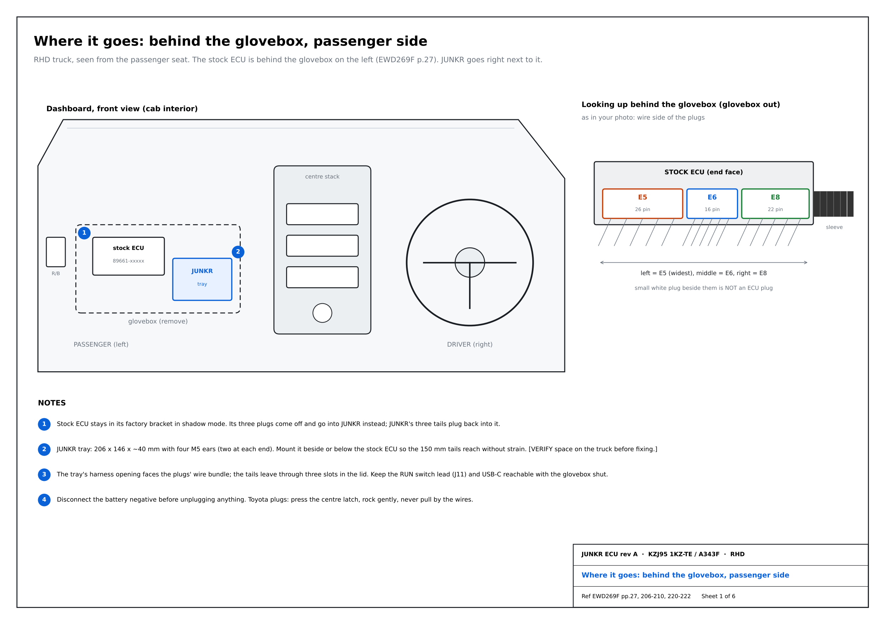
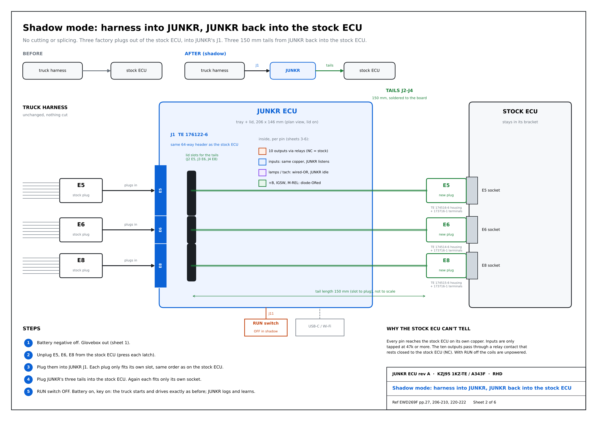
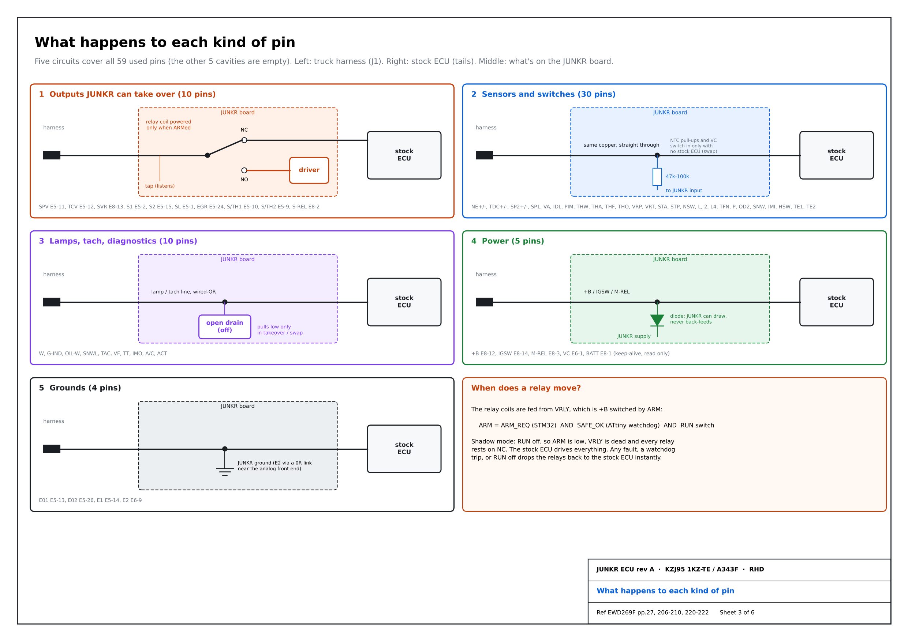
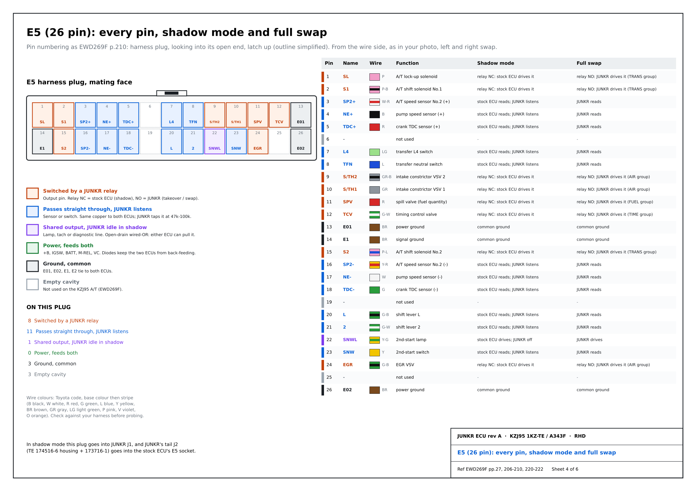
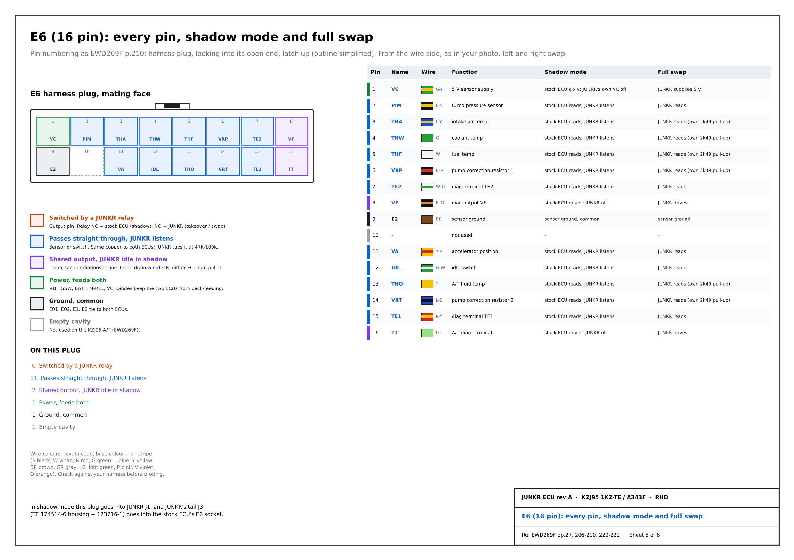
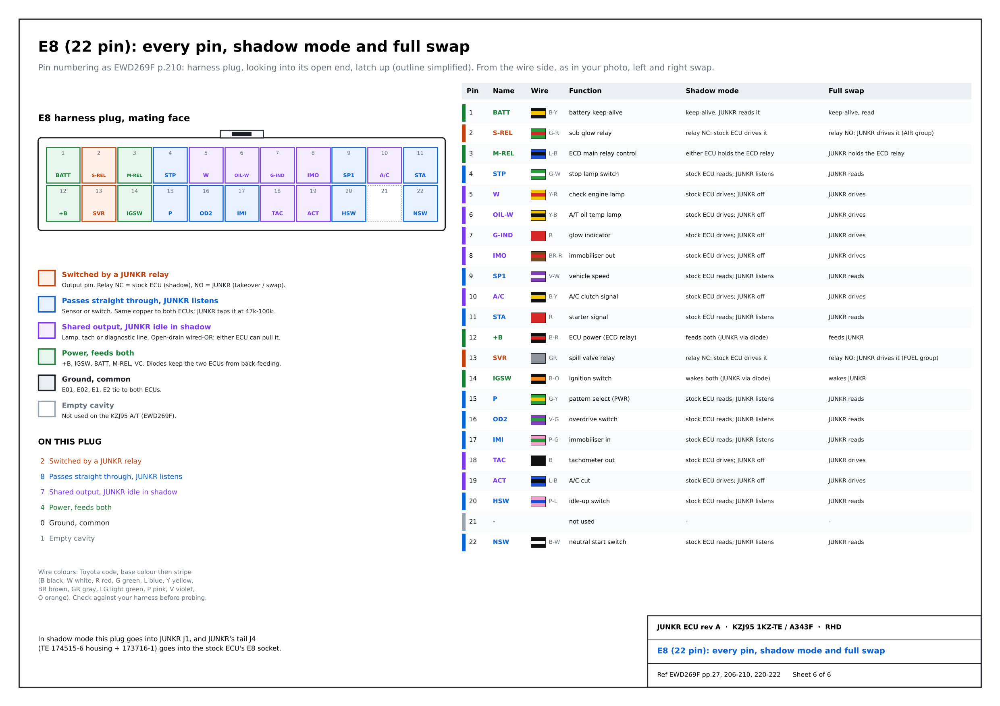

# Installing in the truck

The board's main connector, J1, is a TE 176122-6: the same 64-way header
the stock ECU uses. The truck's E5, E6 and E8 plugs go straight into it.
There is no cutting, splicing or adapter harness, in either mode.

## Where it goes

The stock ECU is behind the glovebox on the passenger (left) side of the
RHD truck (EWD269F p.27). JUNKR's tray mounts right beside it.

## Shadow mode (first install)

The stock ECU stays connected through three tails: pigtails soldered to the
board at J2-J4 that end in the stock ECU's own plugs. Inputs are shared
(high-impedance taps), and every output JUNKR could take over goes through a
Form-C relay whose resting (NC) side is the stock ECU. With the RUN switch
off the relays never close, so the stock ECU drives exactly as before
while JUNKR learns.

## Full swap

Unplug the tails, take the stock ECU out, switch RUN on. The harness never
moves. With no stock ECU behind the relays, any fault now cuts fuel, which
stops the engine (the safe direction for a diesel).

## What happens to each pin

Every pin on all three plugs, with its wire colour, what it does in shadow
mode and what it does after the full swap:

Pin names and wire colours are from the wiring manual EWD269F (connector
faces p.210, engine control pp.206-209, ECT pp.220-222). What each pin
does on the JUNKR side is read from the board netlist
(`kicad/standalone_ecu/tools/circuit.py`), so the sheets can't drift from
the board.

The sheets are generated by `drawings/gen_connection.py` (connection
sheets) and `drawings/gen_drawings.py` (overview, full swap).

The older one-page overview is still there:
[install_shadow.png](drawings/install_shadow.png),
[harness_pinout.png](drawings/harness_pinout.png).
