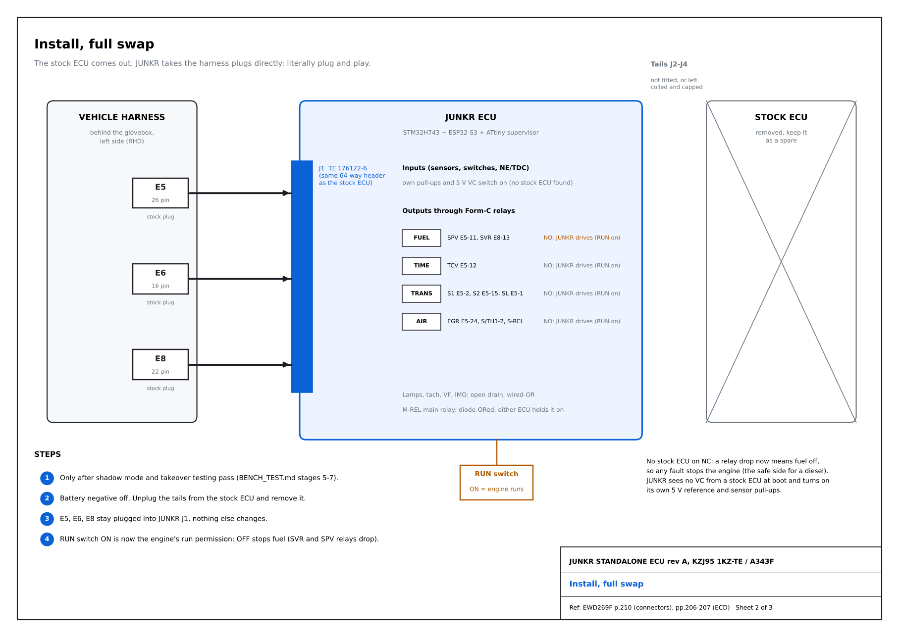
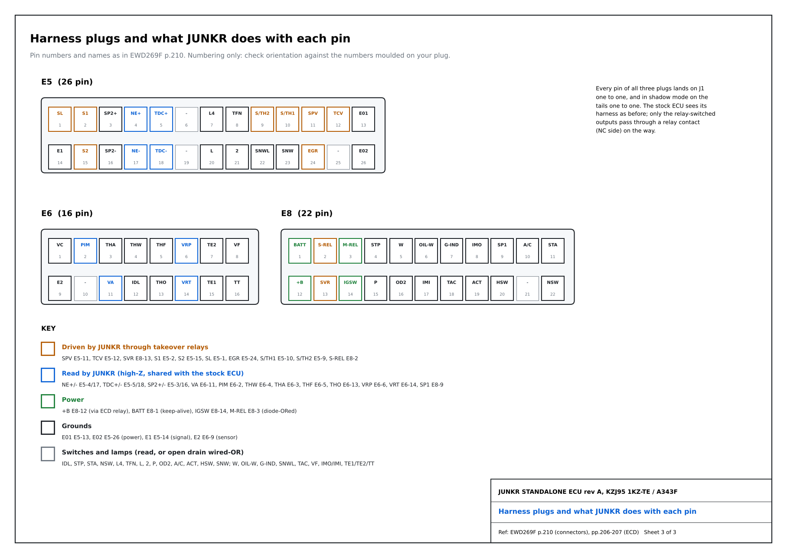

# Installing in the truck

The board's main connector, J1, is a TE 176122-6: the same 64-way header
the stock ECU uses. The truck's E5, E6 and E8 plugs go straight into it.
There is no cutting, splicing or adapter harness, in either mode.

## Shadow mode (first install)

The stock ECU stays connected through three tails: pigtails soldered to the
board at J2-J4 that end in the stock ECU's own plugs. Inputs are shared
(high-impedance taps), and every output JUNKR could take over goes through a
Form-C relay whose resting (NC) side is the stock ECU. With the RUN switch
off the relays never close, so the stock ECU drives exactly as before
while JUNKR learns.

## Full swap

Unplug the tails, take the stock ECU out, switch RUN on. The harness never
moves. With no stock ECU behind the relays, any fault now cuts fuel, which
stops the engine (the safe direction for a diesel).

## Pin reference

From the wiring manual EWD269F (p.210 connector list, pp.206-207 ECD
system). The full table with wire colours is in
[ECU_INTERPOSER_RESEARCH.md](../ECU_INTERPOSER_RESEARCH.md).

The drawings are generated by `drawings/gen_drawings.py`.
