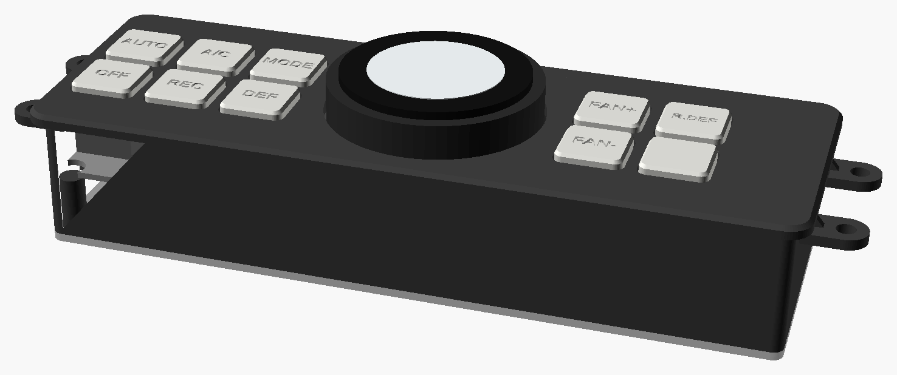

# Climate panel replacement

A printed face for the stock climate control panel: the same buttons on MX
key switches, and an M5Stack Dial as one big temperature knob. Design,
restrictions and what to measure: [`docs/CLIMATE_PANEL.md`](../../docs/CLIMATE_PANEL.md).
Build guide source: [`docs/climate_panel/build_guide.html`](../../docs/climate_panel/build_guide.html).

- `cad/params.scad`: every dimension and the button list. `[MEASURE]` marks a guess.
- `cad/panel.scad`: `part=` faceplate, switch_plate, cap (`cap_i=`), rear_cover, sleeve, fit_frame, cap_test, exploded, assembly.
- `cad/export_all.sh`: rebuilds `stl/` and `renders/` (OpenSCAD 2021+, `xvfb-run` for headless renders).

Print `fit_frame.stl` and `cap_test.stl` before anything else.
