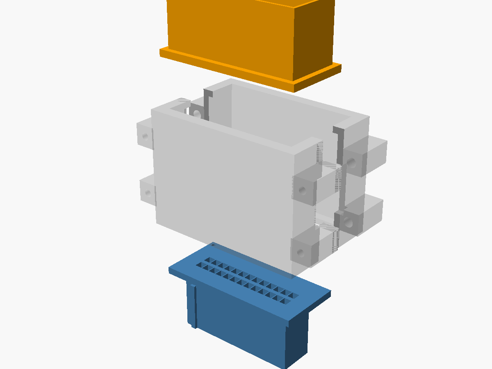

# ECU Interposer (1KZ-TE, KZJ95)

A printable, modular pass-through that plugs in between the 1KZ-TE engine
ECU and its harness. Nothing on the truck gets cut. Each of the ECU's three
plugs (A22 / B16 / C26) gets its own independent section, so you can
install only the ones carrying the signals you want.



```
 ECU header ◀── female_plug ─┬─ chamber (2 halves) ─┬─ male_shroud ◀── OEM harness plug
  (176122-6)   (Multilock     │   pigtails + taps    │  (copy of 176122-6,
                receptacles)  │   ribbon out ──▶ tap box (ESP32-S3)   Multilock tabs)
```

- **Research and pinout:** [`docs/ECU_INTERPOSER_RESEARCH.md`](../../docs/ECU_INTERPOSER_RESEARCH.md)
- **Electronics and logging:** [`docs/ECU_TAP_ARCHITECTURE.md`](../../docs/ECU_TAP_ARCHITECTURE.md)

## Dimensions: where they come from

The header side is no longer a guess. The ECU's header is **TE 176122-6**,
and every cavity, rib, slot, rail, row and column position in
`cad/sections.scad` is measured from TE's 3D model of it (via rusEFI). The
details and all the TE part numbers are in
[research §2](../../docs/ECU_INTERPOSER_RESEARCH.md#2-ecu-location-and-connectors).


*C26 cut across the mating axis. Top: `male_shroud`, a copy of the
header cavity with its key slots and end rails. Bottom: `female_plug`,
with key ridges that ride in the header's slots and a cavity per pin.*

Two things are still estimates, marked **[MEASURE]** in `params.scad`:

- the receptacle and tab **body sizes** inside the printed parts (`T040`,
  `T070`), which only matter for how the metal terminals seat;
- the OEM plug's **latch**. The header model has no lock ramp, so the
  shroud has an optional `lock_window` you can switch on once it's measured.
  Until then the chamber clamp and a zip-tie hold everything together.

## Exploded view and cross-section analysis

[`diagram/connector_diagram.pdf`](diagram/connector_diagram.pdf) ([PNG](diagram/connector_diagram.png))
shows the C26 section exploded with every terminal, then two true-scale
sections: across the pins (pitch, rows, keys, webs) and lengthwise through
a 070 and a 040 column (how far each tab engages). Rebuild it with
`python3 diagram/make_diagram.py` (needs OpenSCAD, xvfb-run, matplotlib).

## Printing

1. Print **`stl/fit_coupon.stl`** first: a 4-column slice (070, 040, 040,
   070) of each side at the real pitch. Check that the female block slides
   into the ECU header, that the OEM plug's terminals enter the male block,
   and that real terminals click in and hold.
2. Adjust `cad/params.scad` (`clr`, `slide_clr`, `T040`, `T070`) if needed.
3. Run `cad/export_all.sh` (OpenSCAD ≥ 2021), then print the sections.

- **Terminal-holding parts** (`female_plug`, `male_shroud`, coupon): the
  thinnest wall between cavities is about **0.35 mm** where a 070 column
  meets a 040 column (OpenSCAD echoes a warning). That's the same as OEM
  but too fine for 0.4 mm-nozzle FDM. Print them in **resin
  (tough/ABS-like)** or order **MJF PA12**. Orientation is already set:
  the plug prints front face down, the shroud prints flange down.
- **Chamber halves and tap box:** FDM is fine, in PETG or ASA. The ECU sits
  behind the glovebox, so these see cabin temperatures, not engine-bay.
  The chamber halves export split face down.
- **Hardware:** 4 × M2 × 10 self-tappers per section, 4 × M2.5 × 5 for the
  tap PCB, and one 4 mm zip-tie per section to the ECU bracket.

## Files

| Path | What |
| --- | --- |
| `cad/sections.scad` | The measured 176122-6 geometry: per-section cavity length, columns (040/070), key slots, rails |
| `cad/params.scad` | Process clearances, terminal body envelopes **[MEASURE]**, chamber and tap box |
| `cad/interposer.scad` | Library: `female_plug`, `male_shroud`, `chamber_half`, `tapbox_base/lid`, `section_assembly` |
| `cad/main.scad` | Top level. Choose with `-D part=... -D sec_i=...` (0 = A22, 1 = B16, 2 = C26) |
| `cad/fit_coupon.scad` | Fit test slice |
| `cad/diagram.scad` | Diagram scene: terminals, pigtails, exploded / cut views (not for printing) |
| `cad/export_all.sh` | Regenerates every STL into `stl/` |
| `stl/` | Pre-exported STLs, print-oriented |

## Assembly (per section)

1. Crimp a ~40 mm pigtail for each pin: a receptacle on one end and a tab on
   the other, using the same wire gauge as OEM (terminal part numbers in research §2.2) (0.3–0.5 mm² signal, 0.85 mm²
   for 070 pins).
2. Load the receptacles into `female_plug` and the tabs into `male_shroud`.
   **Keep pin positions mirrored correctly:** A-1 on the plug must connect
   to A-1 on the shroud. The pin-1 dots on both flanges sit on the same
   corner.
3. For each tapped pin, solder a **47 kΩ+ series resistor** at the pigtail
   (see the architecture doc), then add ribbon to the tap box.
4. Close the chamber halves over both flanges, screw them together, and
   route the ribbon out of the side slot.
5. With the key off: unplug the OEM plug from the ECU, plug the interposer
   into the ECU, then plug the OEM plug into the interposer.
6. **Before starting the engine**, check every pin end to end with a meter
   (OEM side ↔ ECU side).
