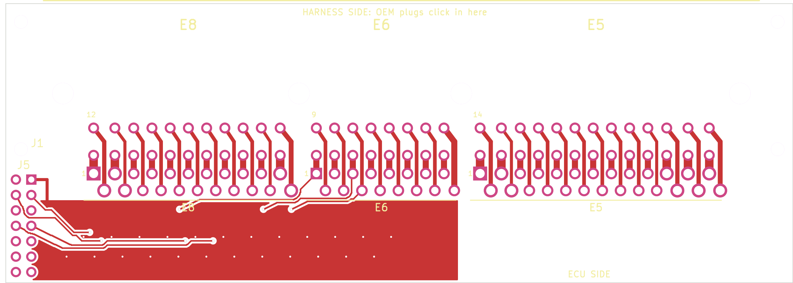
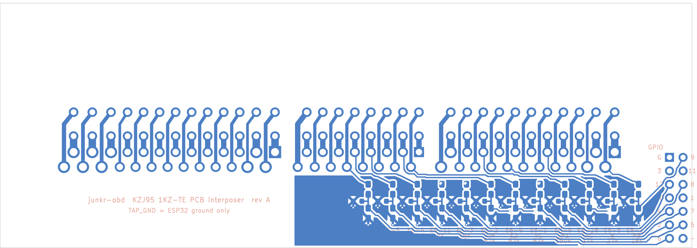

# PCB interposer (rev A, draft)

One 2-layer board that sits between the ECU and all three harness plugs.
It replaces the printed plug + chamber + shroud stacks and their
76 crimps and 12 splices. The why and the trade-offs are in
[`docs/PCB_INTERPOSER.md`](../../docs/PCB_INTERPOSER.md).

| Top (harness edge up) | Back (mirrored) |
| --- | --- |
|  |  |

- **J1: TE 176122-6**, the ECU's own right-angle header. The OEM plugs
  click into it.
- **J2 to J4: tail pads.** These take the 20 to 25 mm wires of the three
  female plugs that go into the ECU. Upper-row tails land on the row
  nearer the header.
- **64 pass-throughs.** Every header pin runs straight to its tail pad
  on both copper layers. Nothing else touches 52 of them.
- **12 dividers on the back.** Each is a 100k top resistor and a bottom
  resistor of 82k, 18k, 27k or 150k, with an optional 10 nF cap. Values
  and pins are the stage 1 pin map from
  [`docs/BUILD_STAGES.md`](../../docs/BUILD_STAGES.md).
- **J5: 2x7 2.54 mm header** to the ESP32-S3-DevKitC. TAP_GND is the
  ESP32's ground and never connects to the ECU's grounds.

## J5 pinout

| J5 | GPIO | Signal | | J5 | GPIO | Signal |
| --- | --- | --- | --- | --- | --- | --- |
| 1 | GND | TAP_GND | | 2 | 9 | +B (E8-12) |
| 3 | 3 | W (E8-5) | | 4 | 11 | TAC (E8-18) |
| 5 | 12 | SP1 (E8-9) | | 6 | 8 | VC (E6-1) |
| 7 | 10 | E2 (E6-9) | | 8 | 1 | PIM (E6-2) |
| 9 | 4 | THA (E6-3) | | 10 | 7 | VA (E6-11) |
| 11 | 2 | THW (E6-4) | | 12 | 5 | THF (E6-5) |
| 13 | 6 | THO (E6-13) | | 14 | | spare |

The order follows the board layout. The GPIO numbers are printed next to
each pin on the back.

## Files

| File | What |
| --- | --- |
| `gen_board.py` | Builds the board: outline, footprints, nets, the 64 locked pass-throughs, the divider cells |
| `route.py` | Routes the 24 tap connections (a small two-layer maze router), pours TAP_GND, writes `interposer.kicad_pcb` and the footprint library |
| `export_scene.py` | Writes `hardware/ecu_interposer/cad/pcb_board_data.scad` for the 3D renders and the tray/lid CAD |
| `interposer.kicad_pcb` / `.kicad_pro` | The board (KiCad 7). It has no schematic: the netlist is the pinout CSV plus the table above |
| `junkr_interposer.pretty/` | Footprints, including the 176122-6 drawn from the measured rusEFI pad positions |
| `gerbers/` | Gerbers and the drill file, ready for JLCPCB/PCBWay (2 oz copper) |
| `bom.csv` | Parts with links |

Rebuild everything:

```sh
cd kicad/interposer
python3 gen_board.py && python3 route.py && python3 export_scene.py
kicad-cli pcb export gerbers -o gerbers/ -l F.Cu,B.Cu,F.SilkS,B.SilkS,F.Mask,B.Mask,Edge.Cuts interposer.kicad_pcb
kicad-cli pcb export drill -o gerbers/ interposer.kicad_pcb
../../hardware/ecu_interposer/cad/render_pcb.sh
```

DRC (KiCad 7, through `pcbnew.WriteDRCReport`): **0 errors, 0 unconnected.**
The only warnings left are footprint-vs-library mismatches and silk at the
harness edge, where the header's mouth line runs along the board edge.

## Copper

- **070 pins** (power, grounds, SPV, TCV): 1.4 mm on both layers for the
  upper row. The lower row is 0.5 to 0.8 mm per layer between pads, about
  3 to 12 mm long. Order **2 oz** copper.
- **040 pins**: 1.0 mm (upper) and 0.6 mm (lower) on both layers.
- **Clearance**: 0.2 mm minimum, 0.25 mm on the pass-throughs.

## Before ordering: check these

1. **Pad numbering.** The rusEFI footprint numbers E8 = 1 to 22,
   E6 = 23 to 38 and E5 = 39 to 64, with the far row as the upper cavity
   row. That matches the Toyota numbering in `pinout_kzj95_at.csv`, but
   check it on a real header with a meter. It only moves which pins the
   dividers sit on; the pass-throughs are correct either way.
2. **176122-6 board pegs.** They are drawn as 3.5 mm unplated holes,
   copied from the rusEFI footprint.
3. **Clearance at the ECU face.** The board stops 21 mm in front of the
   header pins, which is about 4 mm short of the ECU's header mouth with
   an OEM-length plug. Measure the plug and the ECU face.
4. **Print one 1:1 paper copy** of `img/board_top.png` and lay a real
   header on it.
